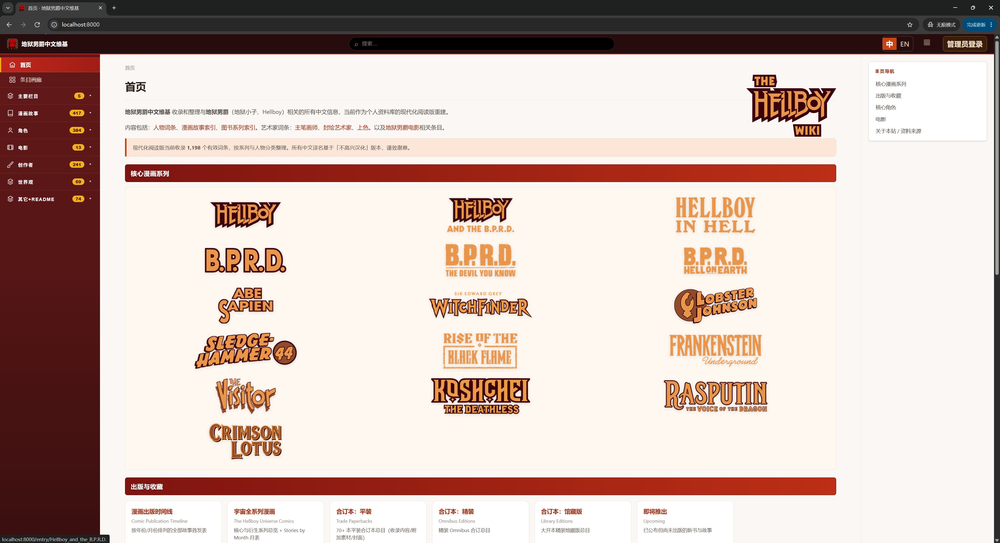
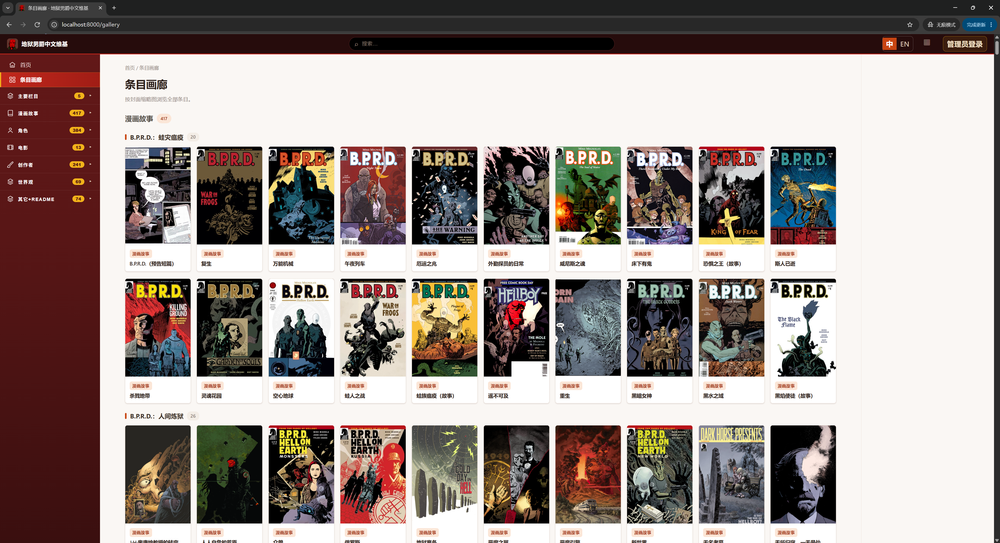
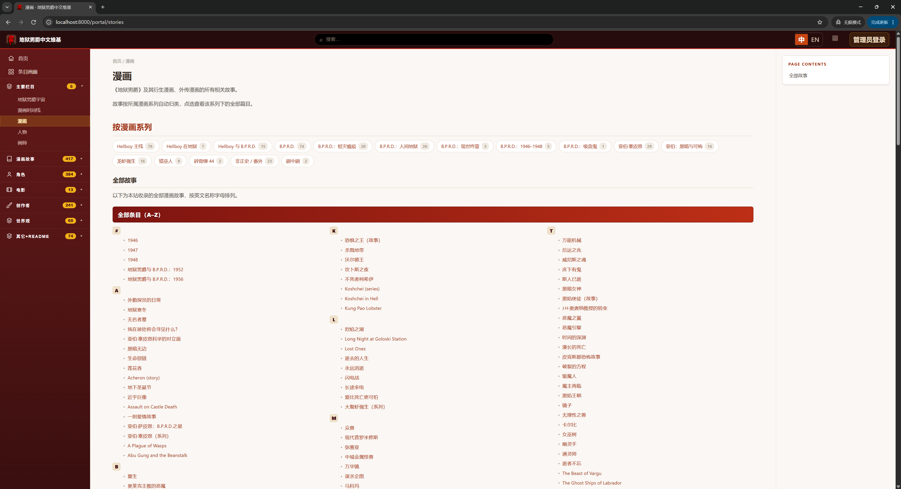
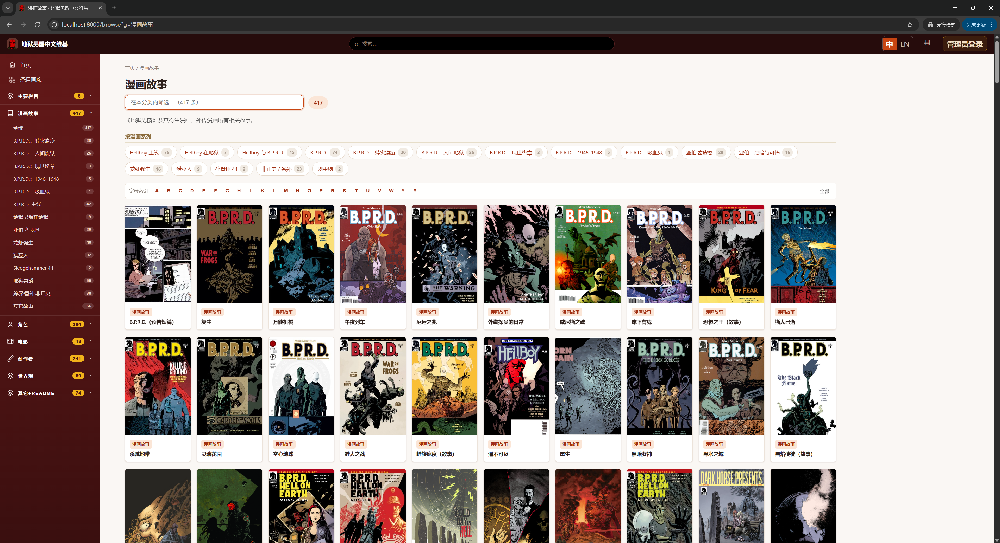
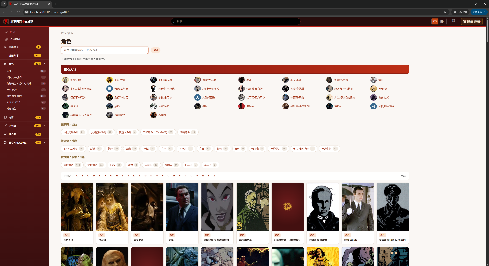
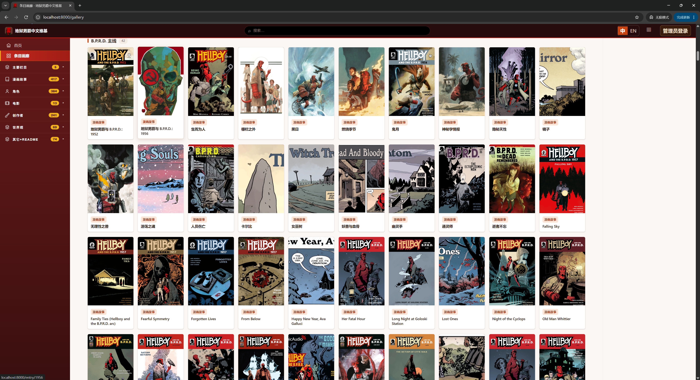
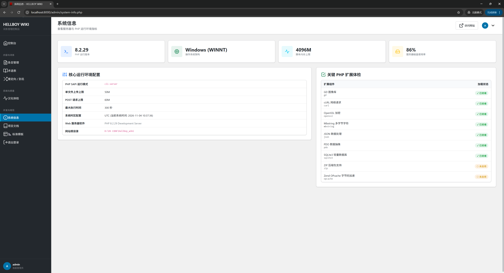

# hellboy_wiki

> 地狱男爵中文维基 ｜ hellboy.wiki ｜ lang=zh ｜ by rzx.me

## 项目简介

- 收录和整理与**地狱男爵**（地狱小子、Hellboy）相关的所有中文信息
- 当前作为站长个人资料库的**现代化阅读版**重建
- 早期基于 MediaWiki 起步，如今以阅读体验为核心重构

## 内容收录

- **人物词条**：角色资料与译名对照
- **漫画故事索引**：按系列分类的漫画故事条目
- **图书系列索引**：合订本、丛书系列书目
- **艺术家词条**：主笔画师、封绘艺术家、上色
- **电影条目**：地狱男爵电影相关内容

## 技术栈

- 纯 **PHP + Markdown** 文件驱动
- 不依赖数据库、Docker 或 Node.js
- 管理后台基于 `shared-admin` 子模块（git submodule）

## 站点截图

- **首页**

  

- **漫画故事 · 条目列表**

  

- **漫画故事 · 系列分类**

  

- **图书系列**

  

- **角色浏览**

  

- **条目画廊**（按封面浏览全部条目）

  

- **管理后台 · 系统信息**

  

## 关于本站

- 早期完全开放编辑，如今主要作为站长本人的个人资料库
- 仍欢迎爱好者协助补充译名、纠错、补全条目
- 较复杂的更改请先联系站长，对齐译名与体例

## 资料来源

- 基础英文内容来自 **FANDOM Hellboy Wiki**
- 中文条目为手工翻译 + 机翻初稿
- 另参考维基百科、地狱男爵吧及网络文章
- 所有中文译名基于「不高兴汉化」版本，谨致谢意

## 版权与声明

- 本站**不提供**相关漫画资源下载
- 图文版权归原权利人所有，如涉侵权请联系站长处理

## 联系方式

- 网站：[rzx.me](https://rzx.me)
- 微信：zhenxinfrozen
