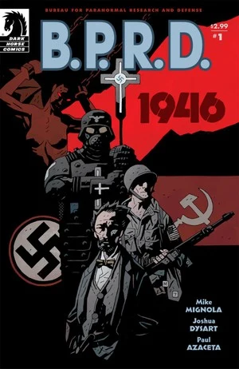
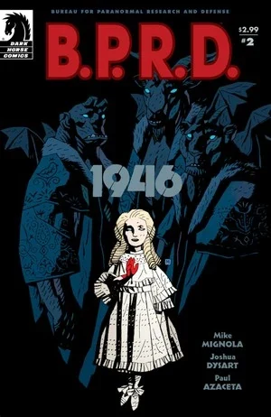
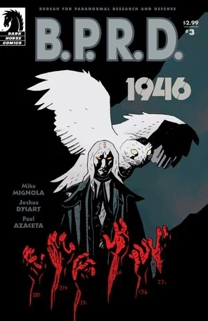
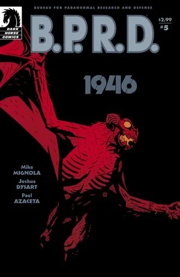

在《**1946**》中，[特雷弗·布鲁滕霍尔姆](/entry/Trevor_Bruttenholm)前往战后的柏林，调查纳粹的神秘学活动。他与苏方同行会面，并揭露了纳粹妄图打造一支吸血鬼大军的阴谋。

## 出版历史

《1946》最初于 2008 年 1 月至 5 月以五期限定迷你系列的形式连载。此后，它与《[奥莱克主教的恶魔](/entry/Bishop_Olek%27s_Devil)》一同收录于 2008 年 11 月出版的平装合订本《[B.P.R.D.：1946](/entry/Trade_Collections)》中。

## 剧情简介

### 第一部

**1944 年 12 月**：一个女人被锁链绑在手术台上。她询问自己家人的下落，身着白大褂的男子与纳粹士兵环立四周。女人露出獠牙、挣脱束缚发起攻击，却被纳粹卫兵制服。

**1946 年，柏林**：[特雷弗·布鲁滕霍尔姆](/entry/Trevor_Bruttenholm)与霍华德·伊顿博士驱车穿行于美军占领区。两人抵达后被引见给当地美军指挥官，告知对方他们的任务是清查、编录纳粹对神秘学的痴迷。指挥官回应说，一支苏联小队已经在审讯一名被俘的神秘学家。为协助工作，军方把一支步兵班仅剩的人马拨给了布鲁滕霍尔姆——五个厌倦了战争、一心想回家的老兵。其中一人 1944 年 12 月恰好驻扎在东布罗姆维奇，亲眼见证了[地狱男爵](/entry/Hellboy_(character))降临人间，[1] 于是同意出手相助。

工作数周后，布鲁滕霍尔姆横穿柏林去与苏联小队会面。他被领进一座堆满古董与怪异器物的大仓库，在里屋见到了苏联神秘学小组的负责人——[瓦尔瓦拉](/entry/Varvara)。她看上去是个苍白的小女孩，言谈举止却带着不容置疑的威严。布鲁滕霍尔姆请她共享档案资料，她直言他不过是想多了解一点「地狱男爵事件」，但仍同意与他分享关于地狱男爵的情报。

翻阅记录后，布鲁滕霍尔姆发现：尽管一家精神病院据称已于 1939 年正式关闭，1945 年却仍有大量液氮被送往那里。他与霍华德·伊顿前往该院调查，找到了一间肮脏的手术室和一张旧蓝图。两人发现了一间地下室并下去探查——他们走进黑暗的房间，丝毫没有察觉头顶正爬过一道道扭曲的身影。

### 第二部

[特雷弗·布鲁滕霍尔姆](/entry/Trevor_Bruttenholm)与霍华德·伊顿继续探查废弃的精神病院。配属给他们的步兵找到了两人，叮嘱他们不要单独行动。

一行人在当地酒吧歇脚喝啤酒。店主告诉他们，曾有一名病人逃出医院、回到了自家农场，并答应带他们前往。布鲁滕霍尔姆最终被放进一间谷仓，在那里见到了那个不死的孩子。那孩子一见到士兵便扑上来，杀死了其中一人。就在他们好不容易把男孩重新关回谷仓时，苏联人与[瓦尔瓦拉](/entry/Varvara)现身了。瓦尔瓦拉进去查看男孩，得知医院里有一间秘密地下室，并在过程中杀死了那个孩子。与她交谈后，布鲁滕霍尔姆意识到：液氮必定是用来让那些生物保持冷冻的，而它们此刻恐怕正在解冻。

美苏两队一同返回精神病院。途中，瓦尔瓦拉向布鲁滕霍尔姆讲述了纳粹的「吸血鬼风暴」计划（Vampir Sturm）：希特勒在见过弗拉基米尔·久雷斯库之后，下令处死这名吸血鬼和他的新娘们，但在处决前，他命人先抽干了其中一位新娘——安娜·久雷斯库——的血。

布鲁滕霍尔姆问瓦尔瓦拉究竟是什么来历。她讲了一个关于彼得沙皇的故事：沙皇曾召唤三名恶魔助战，凭其之力赢得战役；三名恶魔中的一个决定留下来，戴着人类的面孔行走世间。

一行人在满月之下抵达了精神病院。

### 第三部

**1945 年**：一名纳粹军官杀死了精神病院里最后一个没被送进「浸泡槽」的人，那人的尸体落进一个堆满尸体的敞口大坑。

**1946 年**：[特雷弗·布鲁滕霍尔姆](/entry/Trevor_Bruttenholm)、[瓦尔瓦拉](/entry/Varvara)率美苏两队重返精神病院。依照蓝图，众人前去搜查一处此前遗漏的地下室。吸血鬼们悄悄拖走了队里的士兵；怪物发起袭击，一片混乱之中，布鲁滕霍尔姆与瓦尔瓦拉趁部队拼死突围时溜进了那间隐秘的地下室。

两人走进一间摆满成排大型玻璃容器的房间，每个容器里都封存着一个处于冬眠状态的吸血鬼。瓦尔瓦拉找到隐藏的记录，得知最终有 120 名受试者被选中、注射了吸血鬼之血，其余的人则全被杀死。但房间里只剩 20 个容器——意味着有 100 个已被转移。

一个自称柯尼希男爵的吸血鬼现身，告诉他们容器里的吸血鬼都是久雷斯库的子嗣，一旦获释，将给人类上惨痛的一课。他说久雷斯库因愚蠢而罪有应得，但他的妻子们——尤其是安娜——本不该遭此劫难。男爵继续威胁布鲁滕霍尔姆，瓦尔瓦拉却喝令他住口。她显出恶魔本相，逼那吸血鬼俯首。男爵称在他来到医院之前那 100 个吸血鬼就已被运走，他也不知去向，随即化作一只白色猫头鹰飞走。

两人离开医院，与幸存的士兵会合——许多人已经丧命，其中包括霍华德·伊顿。

### 第四部

回到苏联总部，[特雷弗·布鲁滕霍尔姆](/entry/Trevor_Bruttenholm)与[瓦尔瓦拉](/entry/Varvara)审讯一名被苏方关押、与精神病院有关联的男子。布鲁滕霍尔姆说服瓦尔瓦拉让他单独审问。此人名叫弗里德里希·曼施泰因，军衔步兵上将，他向布鲁滕霍尔姆讲述了自己的经历。

120 名病人被注射吸血鬼之血并冷冻时，他就在场。与布鲁滕霍尔姆的担忧相反，「吸血鬼风暴」并非一支新军的核心——连希特勒都没有疯狂到相信自己能驾驭一支吸血鬼大军——而是一件孤注一掷的终极武器：一旦德国战败，他就把这些吸血鬼放到世上。1945 年 4 月 30 日（即他自杀当天），希特勒向曼施泰因下达了释放吸血鬼的命令。但曼施泰因没有从命，他赶回精神病院，杀死了同袍军官，并把那间屋子砌墙封死。

布鲁滕霍尔姆问起失踪的 100 个容器。曼施泰因答道，唯有柏林地下一处隐秘地堡，才具备让吸血鬼持续冷冻所需的空间与不间断供电。美苏两队火速赶往那座地堡，在里面发现了各式各样的奇异机器。

而在苏联总部，一只巨大的白色猫头鹰——吸血鬼柯尼希男爵——飞入室内，杀死了曼施泰因。

就在众人搜查地堡时，[赫尔曼·冯·克伦普特](/entry/Herman_von_Klempt)发现了他们，并放出他的战争猿（Kreigaffe）要将众人尽数杀死。

### 第五部

美苏两队朝两只战争猿疯狂开火，[赫尔曼·冯·克伦普特](/entry/Herman_von_Klempt)则仓皇遁走。[特雷弗·布鲁滕霍尔姆](/entry/Trevor_Bruttenholm)追了上去，找到了那些失踪的吸血鬼——它们被固定在一间圆形房间的内壁上。布鲁滕霍尔姆暴露了行踪，被一只战争猿按住。

冯·克伦普特告诉布鲁滕霍尔姆，他夺走这些吸血鬼，就是为了把它们放到世间。与此同时，另一只战争猿中计撞坏了一台发电机，地堡随之断电。克伦普特揭晓：他们此刻正身处一枚火箭之内——他随即点火，把自己、布鲁滕霍尔姆、那名美军中士和吸血鬼们一并送上了飞向美国的航程。引擎轰鸣，布鲁滕霍尔姆与中士谁也听不清对方的话，但仍拼命呼喊。中士把唯一的降落伞塞给布鲁滕霍尔姆，让他跳机，自己则留下确保火箭坠毁。布鲁滕霍尔姆恳求一定还有别的办法，中士却把他推出舱门，说没时间争了——倘若「吸血鬼风暴」预示着未来的战斗，那么美国更需要布鲁滕霍尔姆活着，而不是他。

布鲁滕霍尔姆撑开降落伞、安全飘回地面，火箭在他头顶爆炸，所有吸血鬼灰飞烟灭。

布鲁滕霍尔姆降落在法国南部，在医院养伤。瓦尔瓦拉前来探望，问起冯·克伦普特，布鲁滕霍尔姆说他想必已死于爆炸。他问她对「[诸神的黄昏计划](/entry/Project_Ragna_Rok)」了解多少，她告诉他，幕后主使是[格里高利·拉斯普京](/entry/Grigori_Rasputin)。她警告说[地狱男爵](/entry/Hellboy_(character))十分危险，但特雷弗说，他在这孩子身上看到了善。

瓦尔瓦拉临走时告诉布鲁滕霍尔姆，他是她最喜欢的人类。他低声嘟囔了一句：*「那我可真走运。」*

## 画廊

封面均由 [迈克·米格诺拉](/entry/Mike_Mignola)（Mike Mignola）绘制。

\#1

\#2

\#3

\#5

## 注释

[1] 见《[毁灭之芽](/entry/Seed_of_Destruction)》第 1 期。

**Category:Story** **Category:B.P.R.D. story** **Category:B.P.R.D.: 1946–1948 story**
