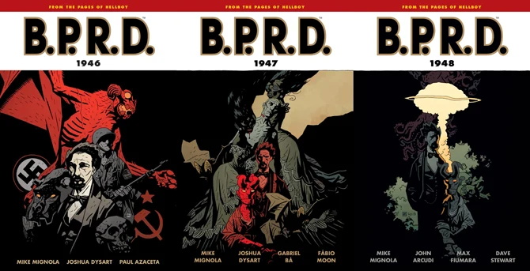
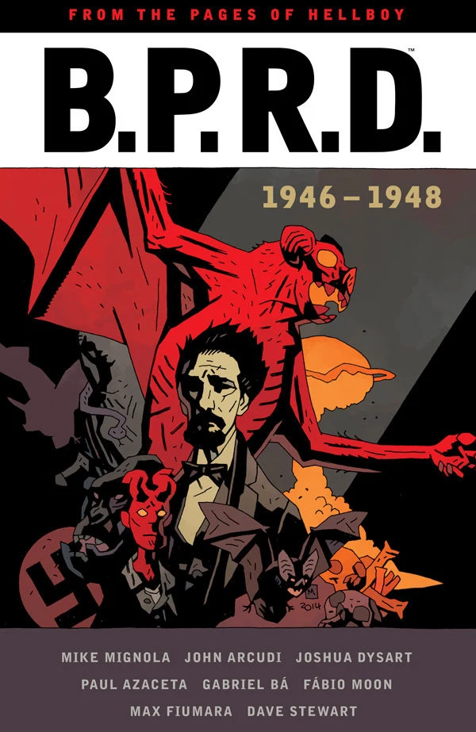

***1946–1948*** is a flashback story cycle, telling the origins of the [B.P.R.D.](/entry/Bureau%20for%20Paranormal%20Research%20and%20Defense) from the late 1940's.

*[1946](/entry/1946)* and *[1947](/entry/1947)* were co-written by [Mike Mignola](/entry/Mike%20Mignola) and [Joshua Dysart](/entry/Joshua%20Dysart), who was going to become a permanent writer of the [*B.P.R.D.*](/entry/B.P.R.D.%20%28series%29) flashback stories while [John Arcudi](/entry/John%20Arcudi) wrote the present day stories. However upon the release of *[1948](/entry/1948)* it was revealed that Arcudi would write the final 1940's *B.P.R.D.* story so he could tie it into the regular series. At one point the trilogy was referred to as "The Secret Origins Trilogy" by Dark Horses's marketing team, but this title has never been used formally.

## Stories Published

- *[1946](/entry/1946)* \#1–5 (January–May 2008)
- *[Bishop Olek's Devil](/entry/Bishop%20Olek%27s%20Devil)* (May 2008)
- *[And What Shall I Find There?](../pages/And What Shall I Find There?.md)* (June 2009)
- *[1947](/entry/1947)* \#1–5 (July–November 2009)
- *[1948](/entry/1948)* \#1–5 (October 2012 – February 2013)

## Collections

*1946–1948* was originally collected in [trade paperbacks](/entry/TPB) without the cycle title, alongside other B.P.R.D. stories.

670 px|center|The three <em>B.P.R.D.</em> 1940s trade paperbacks.

The series was collected in an [omnibus edition](/entry/B.P.R.D.%20Omnibus%20Editions) in June 2015.

220 px|center|The omnibus edition.

**Category:Comics**