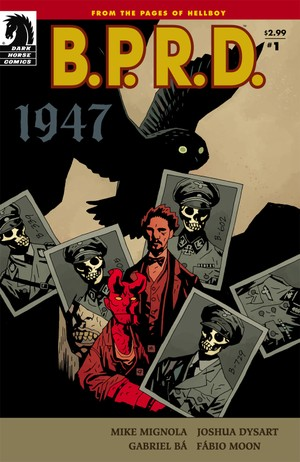
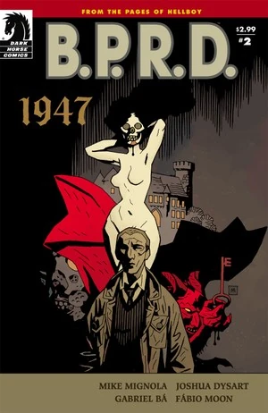
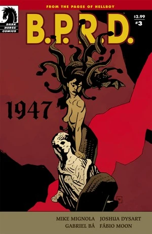
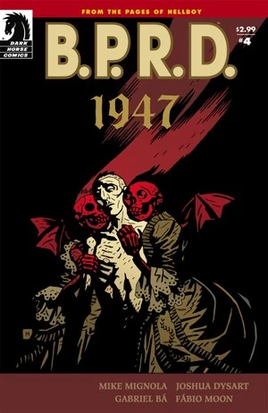
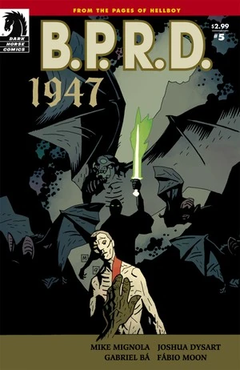

《**1947**》是《B.P.R.D.：1946–1948》系列的第二部迷你系列。

## 出版历史

《1947》最初于 2009 年 7 月至 11 月以五期限定迷你系列的形式连载。此后，它与《[我在彼处将会寻见什么？](/entry/And_What_Shall_I_Find_There)》一同收录于 2010 年 7 月出版的平装合订本《B.P.R.D.：1947》中。

## 剧情简介

### 第一部

1946 年，纳粹神秘学局的「吸血鬼风暴」计划险些摧毁二战结束后脆弱的和平。一年之后，B.P.R.D. 意识到：世上存在着远比纳粹造物更古老、也更危险的生物——一个孤身的吸血鬼贵族，正冷酷无情地追杀第三帝国的幸存者。

### 第二部

当小队其余成员搜寻失踪的同伴时，一名探员独自追随他那位神秘的女恩主，进一步潜入她那个世界的幽暗深处。

### 第三部

B.P.R.D. 最新加入的成员们在一座破败古堡的腹地搜寻失踪的战友，却被径直送进了一群邪恶吸血鬼的獠牙之间。

### 第四部

调查局追猎那名复仇吸血鬼的行动迎来高潮！在奥地利一个诡异的村庄里，数百年前曾举办过一场恐怖的宴会，而赴宴者中的最后一人仍在世间。与此同时，在遥远的美国，年幼的地狱男爵正做着冒险的梦。

### 第五部

双方都伤亡惨重，与吸血鬼的战斗终于落幕。如今布鲁姆（Broom）不得不请一位老友出面，主持一场离奇的驱魔仪式，以拯救一名士兵的灵魂。可这位驱魔人本人对布鲁姆收养的那个小恶魔并无好感——关于如何对抗黑暗势力，他打算给布鲁姆上一课。

## 画廊

封面均由 [迈克·米格诺拉](/entry/Mike_Mignola)（Mike Mignola）绘制。

\#1

\#2

\#3

\#4

\#5

**Category:Story** **Category:B.P.R.D. story** **Category:B.P.R.D.: 1946–1948 story**
