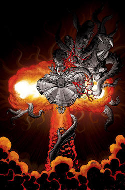
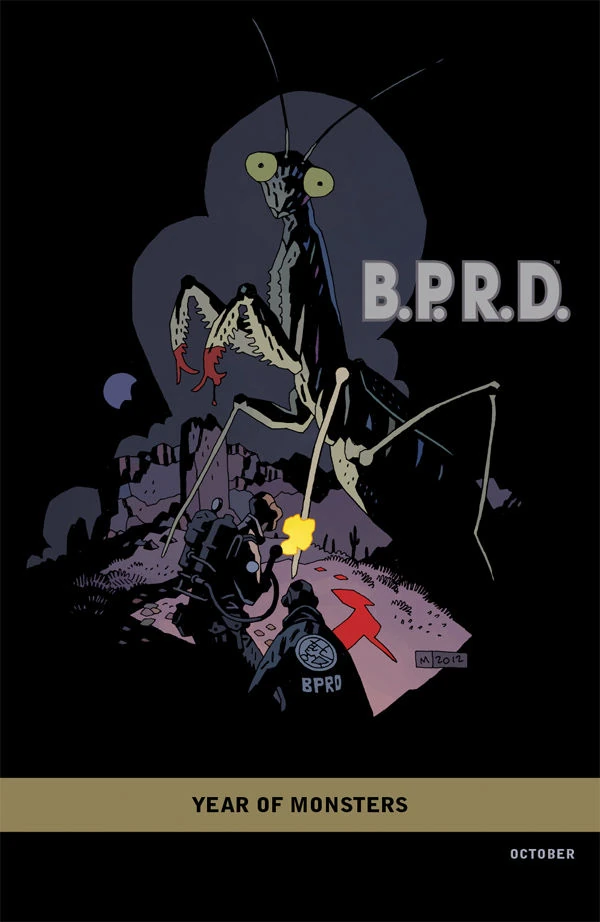
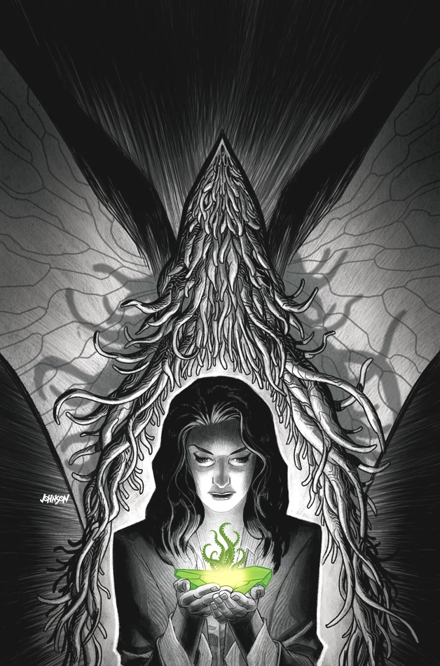
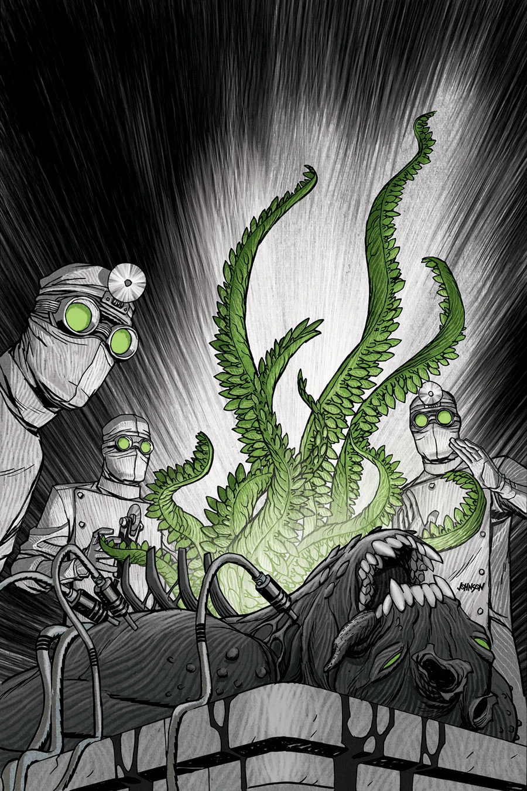
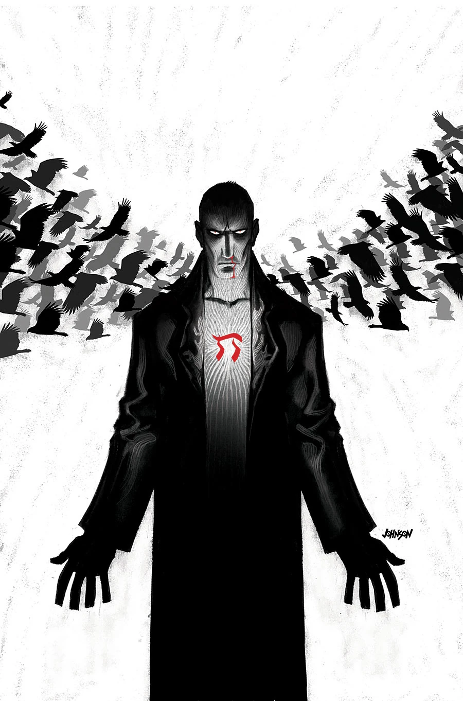

《**1948**》是《B.P.R.D.：1946–1948》系列的第三部、也是最后一部迷你系列。

## 出版历史

《1948》是一部五期限定迷你系列，自 2012 年 10 月起出版，由 [麦克斯·菲乌马拉](/entry/Max_Fiumara)（Max Fiumara）作画。各期封面由戴夫·约翰逊（Dave Johnson）绘制，第 1 期另附一张 [迈克·米格诺拉](/entry/Mike_Mignola)（Mike Mignola）绘制的「怪物之年」（Year of Monsters）变体封面。这也是第一部被排除在 [B.P.R.D. 内部统一期号](/entry/B.P.R.D._(series))之外的《[B.P.R.D.](/entry/B.P.R.D._(series))》迷你系列。

## 剧情简介

### 第一部

纳粹神秘学局曾险些摧毁二战后的和平。战争结束一年后，年幼地狱男爵的监护人布鲁滕霍尔姆教授召集了一支特遣队，把一连串屠杀与一个疯狂的吸血鬼贵族串联起来。如今，B.P.R.D. 又对一项以原子能驱动的太空旅行实验展开调查——这项实验显然已在犹他州的荒漠中放出了骇人的怪物。

### 第二部

原子催生的怪物与 B.P.R.D. 在犹他州荒漠激战正酣，布鲁滕霍尔姆教授与众探员成功击杀了其中一头巨兽，并对其进行尸检，结果令人毛骨悚然。

### 第三部

怪物在犹他州荒漠中不断屠戮平民，这让布鲁滕霍尔姆教授回想起上一次政府行动撕裂现实、从另一个世界放出异物的往事：诸神的黄昏计划（Project Ragna Rok）。

### 第四部

种种迹象都指向在荒漠中发现的那种神秘元素——它正是这些恐怖怪物进入我们世界的源头；与此同时，局里的探员们全力追猎那只最初引发这场混乱的生物。

### 第五部

猜忌在队员之间蔓延：一名科学家开始怀疑，局里的成员正被来自另一个宇宙的存在顶替掉。

## 画廊

除特别注明外，封面均由戴夫·约翰逊（Dave Johnson）绘制。

\#1

\#1「怪物之年」变体封面，[迈克·米格诺拉](/entry/Mike_Mignola)（Mike Mignola）绘

\#2

\#3

\#4

**Category:Story** **Category:B.P.R.D. story** **Category:B.P.R.D.: 1946–1948 story**
