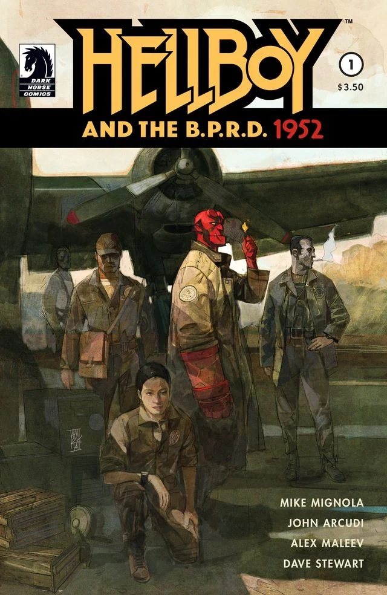
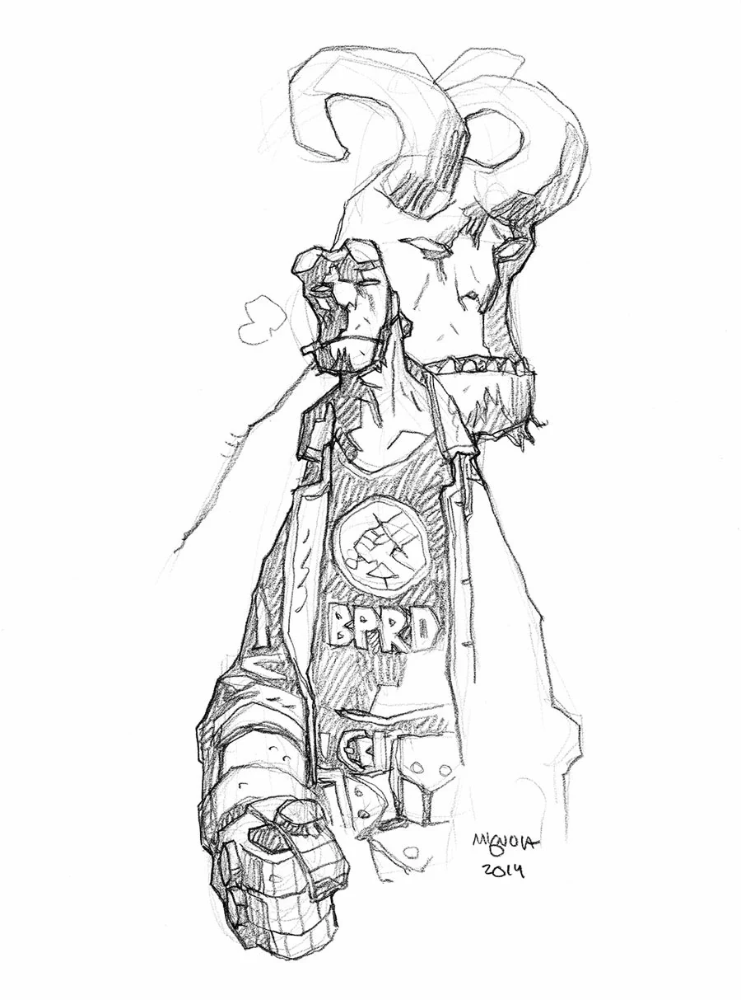
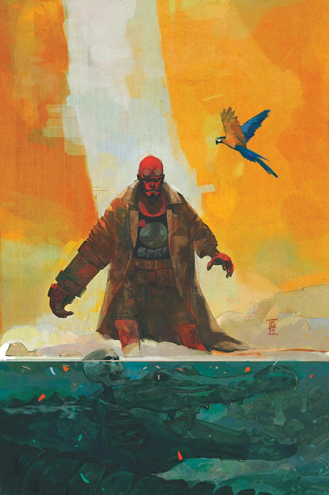
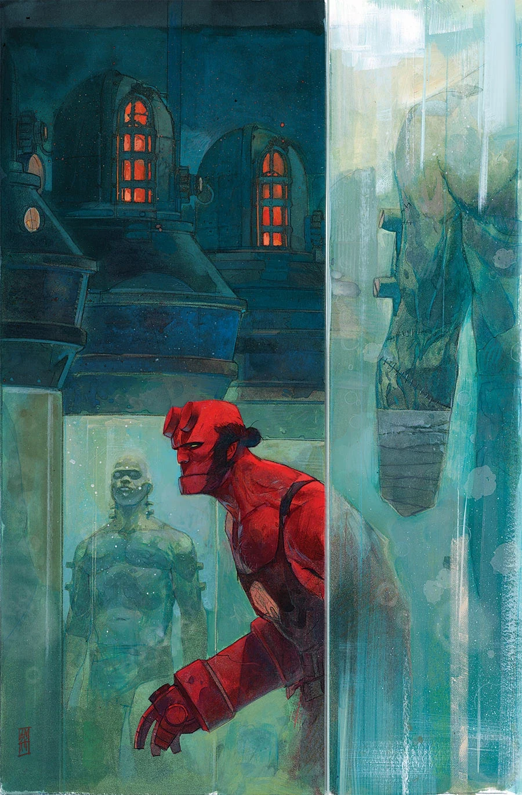
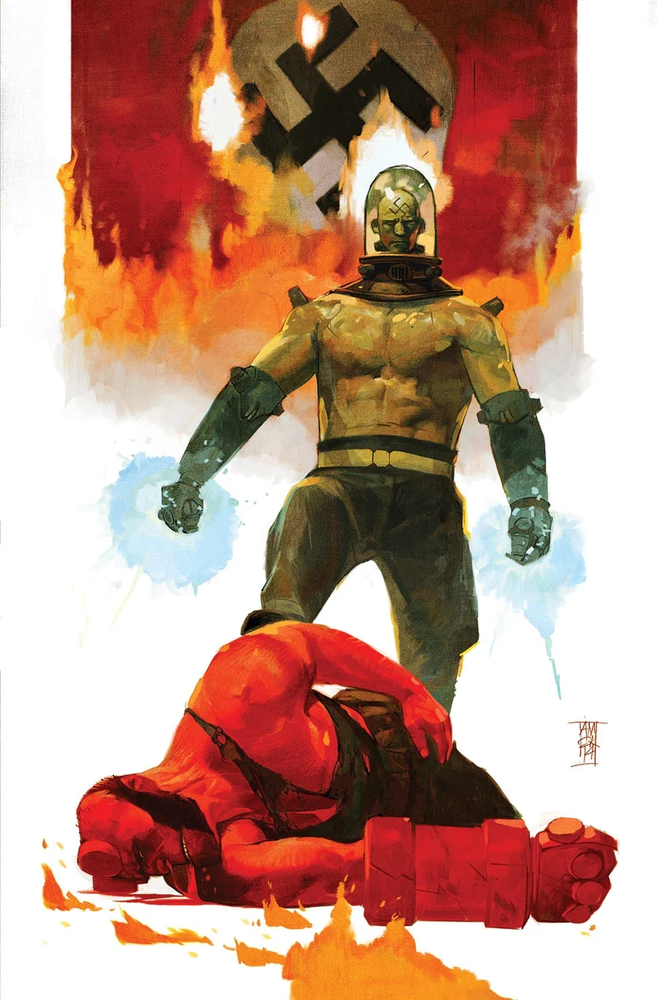

《**地狱男爵与 B.P.R.D.：1952**》是一部五期限定迷你系列，由亚历山大·马列夫（Alexander Maleev）作画，故事设定在 1952 年，讲述[地狱男爵](/entry/Hellboy_(character))的第一次任务。

## 出版历史

该项目在 2014 年圣迭戈国际动漫展（San Diego Comic Con）开幕前几周才刚刚公布。系列各期封面同样由亚历山大·马列夫绘制。

## 剧情简介

### 第一部

一连串离奇凶案，外加关于某种更恐怖之物的传闻，促使[布鲁滕霍尔姆教授](/entry/Trevor_Bruttenholm)把年轻的[地狱男爵](/entry/Hellboy_(character))派往巴西的一座村庄，执行他人生中的第一次任务。地狱男爵与一小队探员，在一座十六世纪葡萄牙要塞的阴影中，掘出了某种可怕的东西……

### 第二部

在巴西，地狱男爵与一小队 [B.P.R.D.](/entry/Bureau_for_Paranormal_Research_and_Defense) 探员调查发生在那座十六世纪葡萄牙要塞阴影下的诡异血腥凶案，可他们揭出的真相，比想象中还要骇人。

### 第三部

地狱男爵的首次任务急转直下——队伍中竟有人反戈相向。面对来自 B.P.R.D. 内部的袭击，以及头顶古老要塞中潜藏的重重恐怖，地狱男爵能否生还？

### 第四部

一场爆炸把地狱男爵冲进下水道，他发现自己迷失在葡萄牙要塞的地下。可当他终于找到出口时，却一头撞进了某种更加凶险的东西之中。

### 第五部

地狱男爵查明了葡萄牙要塞、村庄凶案以及幕后主使的可怕真相。但他能否从怪物与狂徒手中救下自己的探员同伴？

## 画廊

除特别注明外，封面均由 [亚历克斯·马列夫](/entry/Alex_Maleev)（Alex Maleev）绘制。

\#1

\#1 速写变体封面，[迈克·米格诺拉](/entry/Mike_Mignola)（Mike Mignola）绘

\#3

\#4

\#5

**Category:Story** **Category:Hellboy and the B.P.R.D. story** **Category:Hellboy story** **Category:B.P.R.D. story**
