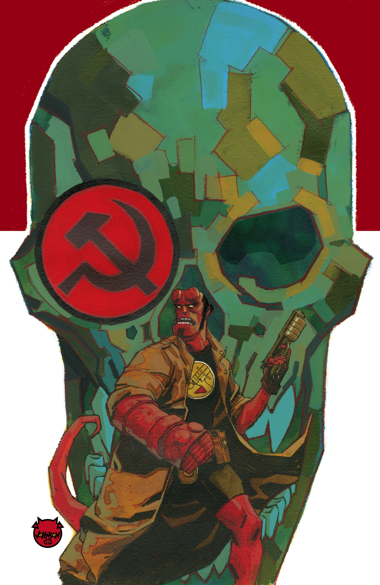
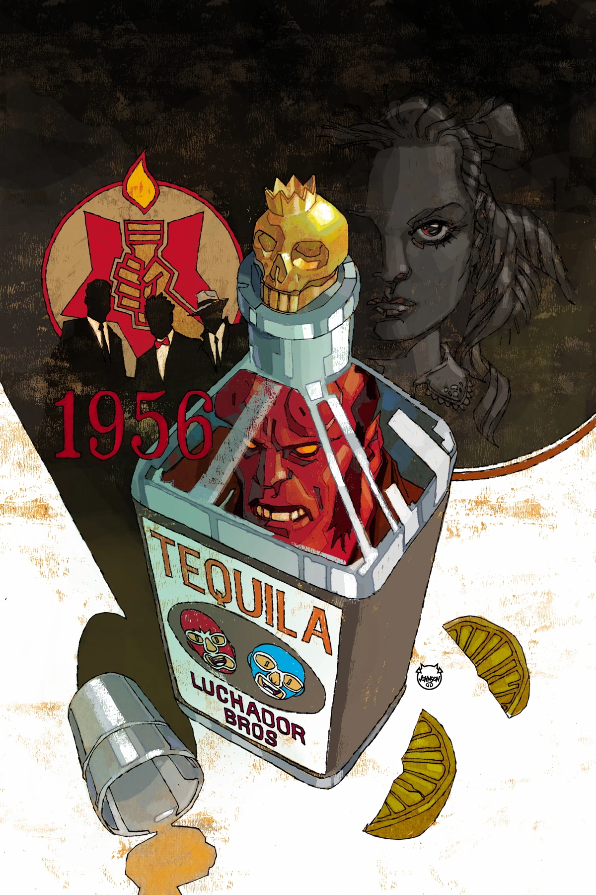
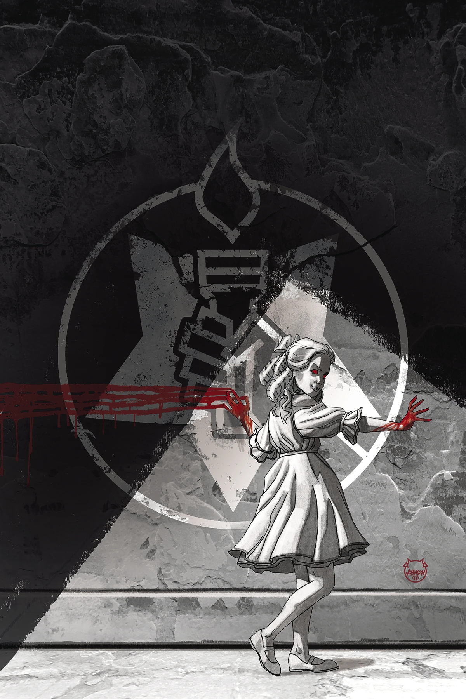
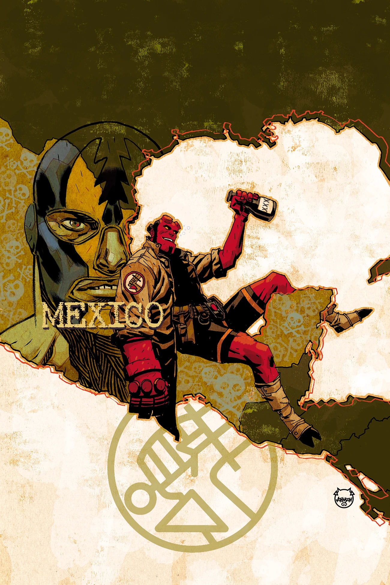

《**地狱男爵与 B.P.R.D.：1956**》是一部五期限定迷你系列，由多位画师共同作画。

## 出版历史

《1956》于 2018 年圣迭戈国际动漫展（San Diego Comic-Con）上正式公布。

## 剧情简介

### 第一部

调查局内部追查苏联秘密计划的压力日益加剧，而一场可疑的掩盖行动促使一名探员脱离监视、独自去寻找答案。与此同时，身为恶魔的苏联神秘学领袖瓦尔瓦拉驱使她的团队随心所欲行事；地狱男爵则被派去执行一项任务——那正是引出他日后在墨西哥那场声名狼藉的荒唐冒险的开端。而在 B.P.R.D. 内外，更隐秘的阴谋也在暗中运作。这部谍战传奇由三条彼此交织的故事线构成。

### 第二部

布鲁滕霍尔姆教授把两名探员派往相反方向，执行不入档案的秘密任务；与此同时，地狱男爵在墨西哥游荡，B.P.R.D. 逐渐失去了他的行踪；而瓦尔瓦拉私心偏爱的项目，也在她的神秘学科学家团队中激起了不满。

### 第三部

特雷弗·布鲁滕霍尔姆博士在他那些不入档案的调查中越陷越深，令 B.P.R.D. 在与苏联同行的角力中苦苦支撑、力求领先一步。与此同时，苏联神秘学小组内部冲突升级，组长瓦尔瓦拉与下属之间的紧张关系濒临爆发。

### 第四部

布鲁滕霍尔姆的秘密调查骤然迎来悲剧性的结局；地狱男爵的缺席迫使他派出 B.P.R.D. 探员前往墨西哥寻人。与此同时，苏联神秘学小组组长瓦尔瓦拉与下属之间的冲突终于彻底激化！

### 第五部

墨西哥对地狱男爵并不友好，但 B.P.R.D. 能否说服他回到总部、去面对那场等待着他的痛苦重逢？与此同时，布鲁滕霍尔姆也不得不直面关于他自己、以及调查局未来的真相。

## 画廊

封面均由 [戴夫·约翰逊](/entry/Dave_Johnson)（Dave Johnson）绘制。

\#1

\#2

\#3

\#5

**Category:Story** **Category:Hellboy story** **Category:B.P.R.D. story** **Category:Hellboy and the B.P.R.D. story**
