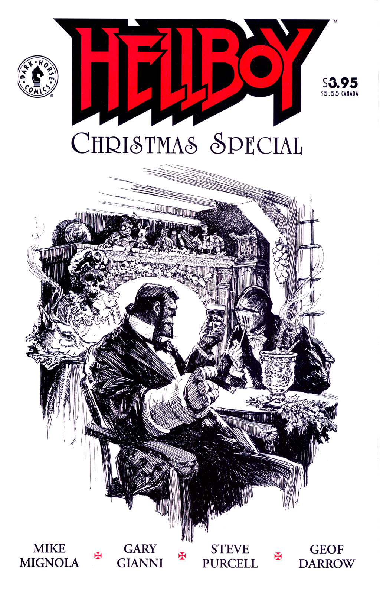

## Publication History

*A Christmas Underground* was first published in December 1997, as part of *Hellboy: Christmas Special*. This Special included work by other writers and artists connected by the themes of Christmas and ghosts. In addition to *A Christmas Underground* the Special included *Ernie's Holiday Ditty* by Steve Purcell; *A Strange Story* by Gary Gianni; *Christmas* by Geof Darrow; *Toybox* by Steve Purcell; *Corpus Monstrum in A Gift for the Wicked* by Gary Gianni; and *Further Reading* by Mike Mignola. The story was reprinted in [*Hellboy – Volume 3: The Chained Coffin and Others*](/entry/TPB) in August 1998.

## Synopsis

[Hellboy](/entry/Hellboy) visits a dying woman in England on Christmas Eve 1989. He learns that the woman's daughter Annie disappeared five years ago, and agrees to give Annie a Christmas present from her mother. It is shown that she delusionally thinks that Hellboy is Santa. Hellboy enters an old grave nearby, and enters a hidden mansion. Annie is there and explains that she followed a mouse with silver eyes into a hole, and married the prince it became there. As her family die, they come to live with her. Annie cannot remember what Christmas is, but Hellboy gives Annie her mother's present, a cross necklace. The ring on her finger unwinds and becomes a lizard, thus breaking the "prince's" hold over Annie. Hellboy fights the now ghoulish family members, and the "prince" himself, a large mouse-like monster. Annie's spirit visits her mother as she dies, and the house burns down.

## Story Chronology

The story takes place on Christmas Eve, December 24, 1989.

! colspan = 3 | [Vol. 3 The Chained Coffin and Others](/entry/TPB)

**Christmas Underground, A** **Christmas Underground, A**