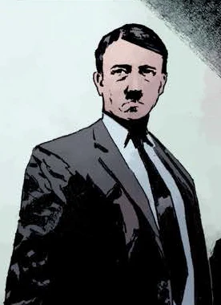

**Adolf Hitler** was the leader of the Nazi party and later Nazi Germany. It was with his approval that many of the Doomsday projects of the Third Reich were either given approval or set to the wayside.

## History

**Adolf Hitler** (20 April 1889 – 30 April 1945) was an Austrian-born German politician who was the leader of the Nazi Party National Socialist German Workers Party). He was Chancellor of Germany from 1933 to 1945 and Führer ("leader") of Nazi Germany from 1934 to 1945. As effectivedictator of Nazi Germany, Hitler was at the centre of World War II in Europe and the Holocaust.

Near the end of the Second World War, faced with possible defeat, a frantic Adolf Hitler launched what the Allies called "The Doomsday Projects". Among these was Project Vampir Sturm (1944, proposed by Heinrich Himmler); [Project Ragna Rok](/entry/Project%20Ragna%20Rok) (The Fatal Destiny), which resulted in the appearance of [Hellboy](/entry/Hellboy) in a church in East Bromwich, England (December 23, 1944); and, lastly, the Nazi Space Program (which brought the [Conqueror Worm](/entry/Conqueror%20Worm)). Regardless in the hopes of winning a losing war against the Allies, these projects never came to Hitler's fruition by the end of the war.

## Posterity

Rasputin himself also references Hitler as he explains his own origins to Hellboy, where he describes him as a small and pathetic man. [Ilsa Haupstein](/entry/Ilsa%20Haupstein) describes him similarly later on.

[Karl Ruprecht Kroenen](/entry/Karl%20Ruprecht%20Kroenen) mentions Hitler in passing when discussing the issue of project Vampir Sturm, supporting his own personal disapproval with the project with the Fuhrer.

[Herman von Klempt](/entry/Herman%20von%20Klempt) reminisces about Hitler and how his dream had died during his return to his long abandoned South American base.

## Note

While Hitler himself never appears in person in the canon Hellboy storyline, he is often mentioned or referenced by other characters. He is first spoken of during the ritual of Project Ragna Rok by one of his officers, who referred to him as "the Fuhrer" and explain his lack of tolerance for failure to Rasputin.

## In "Hellboy" Movie

Like in the comics, Hitler is mentioned several times during the events of Project Ragna Rok. His is also mentioned by [Trevor Bruttenholm](/entry/Trevor%20Bruttenholm) in the modern era as having died in the fifties during the "Occult Wars," contrary to popular belief.

sv:Adolf Hitler

**Category:Characters** **Category:Nazi** **Category:Deceased Characters** **Category:Male Characters** **Category:Humans**