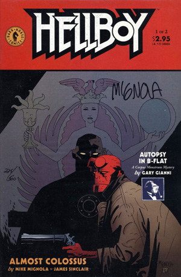

*Almost Colossus* picks up eight days after *[Wake the Devil](/entry/Wake%20the%20Devil)*, and focuses on the homunculus brought to life by Liz.

## Publication History

*Almost Colossus* was originally published as a two issue mini-series, from June to July 1997. These issues contain the two part back up story “Autopsy in B-Flat” by Gary Gianni, featuring the MonsterMen. The story was reprinted with three new pages in *[Hellboy vol. 3 The Chained Coffin and Others](/entry/TPB)*, in August 1998.

## Synopsis

### Part One

The story opens with [Elizabeth Sherman](/entry/Elizabeth%20Sherman) in a hospital in Romania. [Sidney Leach](/entry/Sidney%20Leach) explains to Dr. Olasz, that Liz apparently lost her powers, by putting them into the homunculus, and that she is slowly dying as a result.

Meanwhile, [Hellboy](/entry/Hellboy%20%28character%29) and [Kate Corrigan](/entry/Kate%20Corrigan) search for the missing homunculus, with the hope that he will somehow be able to help Liz. The find a cemetery where 67 bodies have been stolen. The locals tell them that three night ago someone took the cross out of the church and carried it up into the mountains.

The story cuts to the top of the mountain, where the homunculus is praying for an end to his suffering. The homunculus is joined by his older 'brother,' the first homunculus created by their alchemist 'father.' The older homunculus explains their origin, and how he killed their creator and took his secrets. He says he has been working on some sort of project that is approaching completion.

A local says he has seen lights and smells burning bodies in a nearby abandoned castle. Hellboy and Kate go to investigate. The come across a giant hot metal wall, and the floor collapses out from under them. Small creatures, servants of the older homunculus, grab Kate and attack Hellboy.

### Part Two

Liz's condition worsens as part two begins. The elder homunculus reveals his plan, to create a giant new body for the two homunculi from metal and the flesh of humans. With this new body, they will be able to rule the world. He decides to use Kate to christen the giant. The younger homunculus attacks his brother using the power taken from Liz, and protects Kate. Just then Hellboy arrives. The elder homunculus enters his new body and becomes a towering colossus. The giant attacks Hellboy, beating him mercilessly. Just then the younger homunculus asks to be able to join in the giant body, so that they both can rule the world. As he enters the giant, he releases Liz's power and burns up the colossus from the inside. The giant and the elder homunculus destroyed, Hellboy names the remaining homunculus [Roger](/entry/Roger) and takes him to return his power to Liz. Liz returns to full health, but Roger is left lifeless again. Tom Manning decides to take Roger's body back to the [B.P.R.D.](/entry/B.P.R.D.).

## Story Chronology

*Almost Colossus* takes place in 1997, eight days after *[Wake the Devil](/entry/Wake%20the%20Devil)*. This story is followed up by “[Abe Sapien versus Science](/entry/Abe%20Sapien%20versus%20Science)” which takes place somewhere between 1997 and 2000 (likely in 1999).

## Gallery

Covers by [Mike Mignola](/entry/Mike%20Mignola).

文件:Almost Colossus 1.jpg|Issue \#1 文件:Almost Colossus 2.jpg|Issue \#2

! colspan = 2 | [Vol. 3 The Chained Coffin and Others](/entry/TPB) ! colspan = 1 | [Vol. 4 The Right Hand of Doom](/entry/TPB)

sv:Almost Colossus

**Category:Story** **Category:Hellboy story**