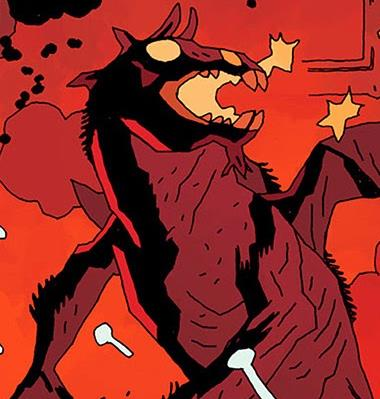

**Amdusias** was a Greater Duke of Hell.

On March 3, 1916, Amdusias was partially conjured by the [Heliopic Brotherhood of Ra](/entry/Heliopic%20Brotherhood%20of%20Ra) in an unknown attempt to control or contain him. The summoning was interrupted by [Sir Edward Grey](/entry/Sir%20Edward%20Grey) who stopped the ritual, but Amdusias dragged Sir Edward to Hell. Having denied his chance to enter the mortal realm, Amdusias cursed Sir Edward with eternal life, tore his body to pieces, and then cast him into the river Acheron.

**Category:Demons** **Category:Male Characters** **Category:Royalty**