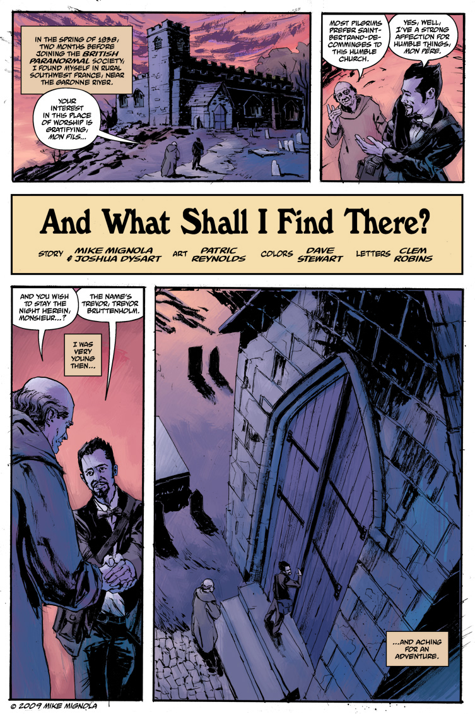

《**我在彼处将会寻见什么？**》（And What Shall I Find There?）是一部短篇故事，时间线设定在特雷弗·布鲁滕霍尔姆的青年时代。

## 出版历史

《我在彼处将会寻见什么？》最初于 2009 年 6 月发表在《MySpace Dark Horse Presents》第 23 期上。此后，它与《[1947](/entry/1947)》一同收录于 2010 年 7 月出版的平装合订本《B.P.R.D.：1947》中。

## 剧情简介

故事发生在 1938 年春天的法国东南部乡间。特雷弗·布鲁滕霍尔姆刚从牛津毕业，正在欧洲大陆游历。他来到一座小教堂过夜，为的是「独自待一会儿……与上帝相处」。其实他是想独占这座教堂，寻找叔叔告诉他的一幅藏在钟楼里的画——画名叫《结巴皮埃尔神父》（Père Pierre le Bègue），画中是这位神父的肖像，他身后立着一头可怖的怪物。当年正是这幅画导致皮埃尔神父和画家都被会众杀害。后来怪物现身，但布鲁滕霍尔姆一把火烧掉画作，将它驱逐。此事之后，布鲁滕霍尔姆说自己再没感受过那样的恐惧——因为初次经历的那种滋味，后来没有任何事能与之相比。

## 致敬与雷同

这个故事与蒙塔古·罗兹·詹姆斯（M. R. James）的鬼故事《教士会长阿尔贝里克的剪贴簿》（*Canon Alberic's Scrap-Book*）有诸多相似：两篇都有一幅描绘恶魔、被邪祟附身的画作，一座闹鬼的教堂，恶魔随后现身惊吓主角，最终又因画作被焚毁而遭驱逐。漫画甚至直接提到了《剪贴簿》故事的发生地——圣贝特朗德科曼日（Saint-Bertrand-de-Comminges）那座教堂。

**Category:Story** **Category:B.P.R.D. story** **Category:B.P.R.D.: 1946–1948 story**
