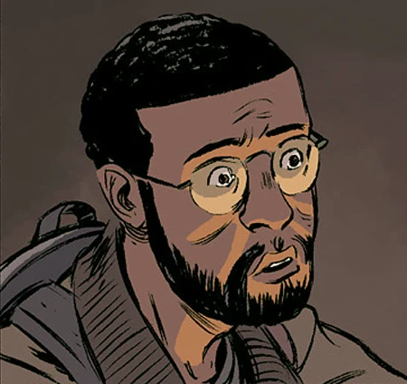

**Andrew Devon** is a former professor of modern and medieval languages from Cambridge. While growing up in St. Louis, Missouri, his interest in the supernatural was piqued when he read [Kate Corrigan's](/entry/Kate%20Corrigan) study of a demonic possession in Azerbaijan.

First appearing in *[The Universal Machine](/entry/The%20Universal%20Machine)*, he was called upon by Dr. Corrigan to help broker a deal for a rare text that may have held the secret to restoring [Roger](/entry/Roger) to life.  Sometime following the incident, he was employed as a [B.P.R.D.](/entry/B.P.R.D.) field agent and eventually rose to become a senior member of the staff. Following the events of *[King of Fear](/entry/King%20of%20Fear%20%28story%29)* he became distrustful of fellow agent [Abraham Sapien](/entry/Abraham%20Sapien), believing him to have a hand in the global apocalypse. This distrust would later lead him to cover up Abe's near fatal shooting at the hands of [Fenix](/entry/Fenix) in New Mexico.  He would later catch up to Fenix and her group in *[The Devil's Engine](/entry/The%20Devil%27s%20Engine)* and escort her on the dangerous journey to B.P.R.D headquarters in Colorado.

Despite coming from an academic background and his relative inexperience as a field agent, Devon has displayed the capacity for quick thinking and decisive action during stressful situations.  His misgivings concerning Abe's loyalty have caused friction between him and Kate and he has at times expressed dissatisfaction with the Bureau's handling of the worldwide crisis.

Doesn't like phone booths.

**Category:Characters** **Category:Male Characters** **Category:B.P.R.D. agent** **Category:Humans** **Category:Americans**