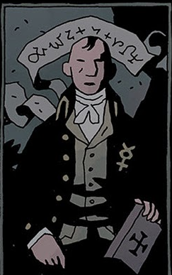

**Angus Weir** was an early 19th century warlock who sold his soul, but then sought to cheat his masters in Hell. In 1813, on All Hallows' Eve, the lords of Hell sent a horde of demons to snatch up Weir and his house from off the coast of Scotland, and brought it to Acheron. Weir did not survived the trip, but with his dying breath he renounced all his evil works and begged that he be forgiven and inscribed magical wards which barred any demon and creature of Hell from ever entering his home.

Weir's home was later visited by [Sir Edward Grey](/entry/Sir%20Edward%20Grey) and [Hellboy](/entry/Hellboy). After Hellboy departed, Angus Weir's spirit conversed with Sir Edward and chastised him for making Hellboy believe he is free when he is destined to do more horrible things.

**Category:Spirits** **Category:Humans** **Category:Deceased Characters**