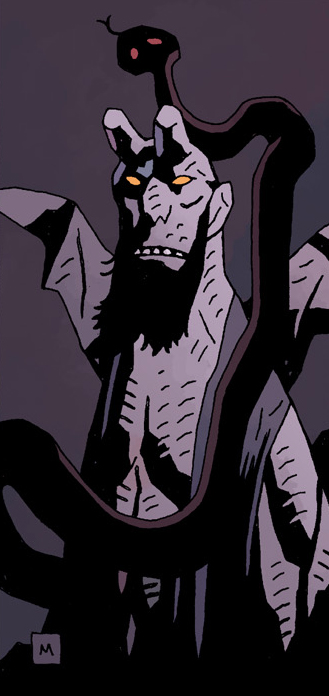

**Astaroth** was a demon and a Grand-Duke of Hell. As [Hellboy](/entry/Hellboy%20%28character%29)'s paternal uncle, he was also one of his oldest antagonists.

## History

Brother to [Azzael](/entry/Azzael), Hellboy's father, Astaroth was unaware of his brother's plans for his infant son, or how he had procured the Right Hand of Doom. But he clearly saw great potential in the power it represented if only Hellboy could be made to claim it. On May 12th, 1947, Astaroth was among the three demon lords to learn that a young [Hellboy](/entry/Hellboy) was becoming more assimilated to mortal life by eating pancakes. Astaroth commented that Hellboy would never want to come back to Hell.[1] However, Astraroth believed he could still win Hellboy back to his heritage.

A year later, Astaroth learnt his niece [Gamori](/entry/Gamori) had lured Hellboy from the safety of [BPRD](/entry/BPRD) headquarters with the Midnight Circus in an elaborate scheme designed to kill the young child. Astaroth stepped in to stop Gamori, unmindful of her warning of the threat Hellboy would one day pose, as he forbade Gamori from making another attempt on Hellboy's life, so long as he still lived.[2]

### [Box Full of Evil](/entry/Box%20Full%20of%20Evil)

Hellboy first knowingly encountered Astaroth during a BPRD mission with [Abe Sapien](/entry/Abe%20Sapien) in Scotland, when the sorceror [Igor Bromhead](/entry/Igor%20Bromhead) invoked the powers of Hell to protect him from Hellboy's wrath. Astaroth appeared on Earth and did so, but when Bromhead accidentally broke the talisman that protected him from Astaroth's power, he turned the lower half of the sorceror's body into that of a lizard. After Hellboy defeated the demon [Ualac](/entry/Ualac), Astaroth seals Ualac back in his prison to be taken back to Hell. When Hellboy refuses to take the removed Crown of the Apocalypse back, Astaroth tells Hellboy that he will keep it with him at Pandemonium until Hellboy is ready to reclaim it.[3]

### [Darkness Calls](/entry/Darkness%20Calls) and the Storm

In 2010, Astaroth saw in the fairy revolt of the [Gruagach](/entry/Gruagach) the chance to force Hellboy to claim his demonic heritage. Just as the rebellion seemed about to falter, Astaroth appeared to the Gruagach and provided the means to ressurect the Queen of Blood - a golden and bejeweled Ciborium containing the blood of every man, woman and child from a nearby murdered village. With Nimue resurrected, Astaroth had knowingly or otherwise set things on the path to Hellboy's eventual death.

He appeared to Hellboy later in the rebellion, showing him the true and horrifying extent of Nimue's forces and urging him to claim his birthright and raise the army of Hell to combat her. When Hellboy refused to do so even at this desperate hour, a disgusted Astaroth left him to his fate.

### [The Descent](/entry/The%20Descent)

When word of Hellboy's death reached Hell, it started a panicked exodus from Pandemonium by Hell's aristocracy. As the only remaining Arch-Duke, Astaroth welcomed Hellboy back to his ancestral home. Having shown Hellboy the imprisoned Azzael and recounted the story of his own birth, Astaroth introduced Hellboy to his half-brothers [Gamon](/entry/Gamon) and [Lusk](/entry/Lusk). Having hoped that Hellboy's death would finally strip him of his humanity, Astaroth now realized his nephew was a lost cause and set his half-brothers on him. During the fight Astaroth decapitated Gamon when the younger demon blasphemed the memory of Azzael. At this Lusk realised the extent of Astaroth's ambition - that whomever managed to claim the power of Hellboy's right hand, Astaroth, as the power behind the throne, would be the true wielder. As they argued, both demons were unexpectedly eaten by the [Leviathan](/entry/Leviathan), with whom Astaroth had had a long-standing grudge. Astaroth's death freed Hellboy from the burden of his right hand and the power it represented, as there was no longer anyone in Hell left who wanted it.

## Sources

<references />

**Category:Characters** **Category:Demons** **Category:Male Characters** **Category:Villains** **Category:Deceased Characters** **Category:Royalty**

[1] "[Pancakes](/entry/Pancakes)"

[2] "[The Midnight Circus](/entry/The%20Midnight%20Circus)"

[3] "[Box Full of Evil](/entry/Box%20Full%20of%20Evil)"