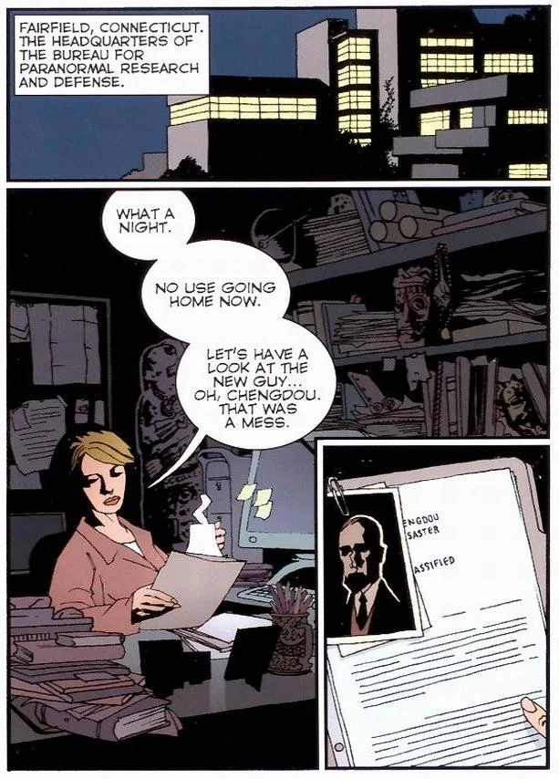

[凯特·考瑞根](/entry/Kate_Corrigan)正在审阅 B.P.R.D. 新招募成员[约翰·克劳斯](/entry/Johann_Kraus)的人事档案。

## 出版历史

这篇三页的短篇以预告形式刊载，为即将推出的漫画《[空心地球](/entry/Hollow_Earth)》造势。它以报纸漫画版式刊登在 *Dark Horse Extra* 第 42–44 期上，时间为 2001 年 12 月至 2002 年 2 月。

该故事后于 2003 年 1 月收录进平装合订本《B.P.R.D.：空心地球及其他故事》（*[B.P.R.D.: Hollow Earth & Other Stories](/entry/Trade_Collections)*）。

## 剧情简介

一天夜里，[凯特·考瑞根](/entry/Kate_Corrigan)独自坐在 [B.P.R.D.](/entry/B.P.R.D.) 总部。她无法入睡，便决定翻阅新成员[约翰·克劳斯](/entry/Johann_Kraus)的档案。

七个月前，约翰·克劳斯正在为一名死者的亲友举行降灵会。就在同一时刻，在中国成都，有人闯入了一栋收藏着强大神秘器物的建筑。克劳斯的意识正处于灵界（ethereal plane）时，一股巨大的力量在中国被释放，由此引发的冲击波吞噬了成都方圆 100 英里内所有人的灵魂。

而在灵界，后果更为严重。那股能量洪流穿过灵界，杀死了降灵会上的每一个人。约翰·克劳斯的肉体被摧毁，但由于他的灵魂当时不在体内，灵魂得以幸存。

凯特·考瑞根评价道，约翰会很好地融入 B.P.R.D.。档案所附的照片上，是一个身着某种密闭防护服的身影。

## 故事年表

故事发生在 2002 年 9 月，即《[通灵师](/entry/The_Ectoplasmic_Man)》之后、《[空心地球](/entry/Hollow_Earth)》之前。

## 内容

### 角色

- [约翰·克劳斯](/entry/Johann_Kraus)（回忆出场）
- 成都事件遇难者（回忆出场）
- [超自然调查防御署](/entry/Bureau_for_Paranormal_Research_and_Defense)（B.P.R.D.）
  - [凯瑟琳·考瑞根](/entry/Kate_Corrigan)
  - [地狱男爵](/entry/Hellboy_%28character%29)（照片）
  - [丽兹·舍曼](/entry/Elizabeth_Sherman)（照片）
  - [罗杰](/entry/Roger)（照片）
  - [亚伯拉罕·塞皮恩](/entry/Abraham_Sapien)（照片）

### 地点

- 美国
  - [B.P.R.D.](/entry/Bureau_for_Paranormal_Research_and_Defense) 总部（康涅狄格州费尔菲尔德）
- 德国（回忆出场）
  - 克劳斯宅邸（海德堡）（回忆出场）
- 中国（回忆出场）
  - 成都（回忆出场）
