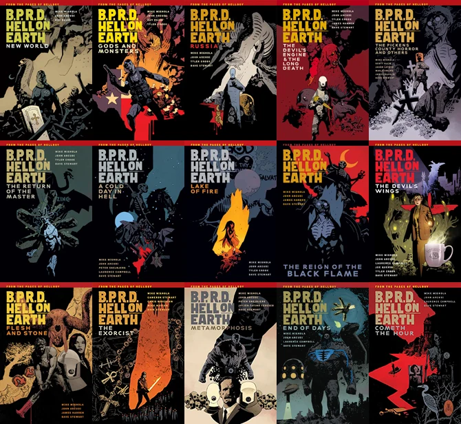
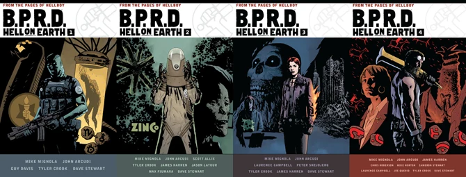

*Hell on Earth* is the second cycle of the ongoing *[B.P.R.D.](/entry/B.P.R.D.%20%28series%29)* stories.

The [*Plague of Frogs* cycle](/entry/Plague%20of%20Frogs%20%28story%20cycle%29) concluded with *[King of Fear](/entry/King%20of%20Fear%20%28story%29)*. All subsequent *B.P.R.D.* miniseries concerned with the ongoing plotline bear the title "*Hell on Earth*" in addition to the title of the miniseries/arc. *Hell on Earth* concluded with *B.P.R.D.* \#147.

## Stories Published

- *[New World](/entry/New%20World)* \#1–5 (August–December 2010)
- *[Gods](/entry/Gods)* \#1–3 (January–March 2011)
- *[Seattle](/entry/Seattle)* (March 2011)
- *[Monsters](/entry/Monsters)* \#1–2 (July–August 2011)
- *[Russia](/entry/Russia)* \#1–5 (September 2011 – January 2012)
- *[An Unmarked Grave](/entry/An%20Unmarked%20Grave)* (February 2012)
- *[The Long Death](/entry/The%20Long%20Death)* \#1–3 (February–April 2012)
- *[The Pickens County Horror](/entry/The%20Pickens%20County%20Horror)* \#1–2 (March–April 2012)
- *[The Devil's Engine](/entry/The%20Devil%27s%20Engine)* \#1–3 (May–July 2012)
- *The Transformation of J.H. O'Donnell* (May 2012)
- *[Exorcism](/entry/Exorcism)* \#1–2 (June–July 2012)
- *[The Return of the Master](/entry/The%20Return%20of%20the%20Master)* \#1–5 (August–December 2012)
- *[The Abyss of Time](/entry/The%20Abyss%20of%20Time)* \#1–2 (January–February 2013)
- *[A Cold Day in Hell](/entry/A%20Cold%20Day%20in%20Hell)* \#1–2 (March–April 2013)
- *[Wasteland](/entry/Wasteland)* \#1–3 (May–July 2013)
- *[Lake of Fire](/entry/Lake%20of%20Fire)* \#1–5 (August–December 2013)
- *[The Reign of the Black Flame](/entry/The%20Reign%20of%20the%20Black%20Flame)* \#1–5 (January–May 2014)
- *[The Devil's Wings](/entry/The%20Devil%27s%20Wings)* \#1–2 (June–July 2014)
- *[The Broken Equation](/entry/The%20Broken%20Equation)* \#1–2 (August–September 2014)
- *[Grind](/entry/Grind)* (October 2014)
- *[Flesh and Stone](/entry/Flesh%20and%20Stone)* #1–5 (November 2014 – March 2015)
- *[Nowhere, Nothing, Never](/entry/Nowhere%2C%20Nothing%2C%20Never)* #1–3 (April–June 2015)
- *[Modern Prometheus](/entry/Modern%20Prometheus)* #1–2 (July–August 2015)
- *[End of Days](/entry/End%20of%20Days)* #1–5 (September 2015 – January 2016)
- *[The Exorcist](/entry/The%20Exorcist)* #1–3 (April–June 2016)
- *[Cometh the Hour](/entry/Cometh%20the%20Hour)* #1–5 (July–November 2016)

## Artists

[Guy Davis](/entry/Guy%20Davis) had been the ongoing artist for *[B.P.R.D.](/entry/B.P.R.D.%20%28series%29)* since the miniseries *[Plague of Frogs](/entry/Plague%20of%20Frogs%20%28story%29)*, however upon the conclusion of the miniseries *[Gods](/entry/Gods)* he announced he would be leaving to work on other projects.

At the same time, [Tyler Crook](/entry/Tyler%20Crook) was announced as the new ongoing artist, though not quite in the same capacity that Davis had been. During Davis's run as the ongoing artist, he was solely responsible for the ongoing stories, however has been sharing these duties with other semi-regular artists. Since then [James Harren](/entry/James%20Harren) and [Laurence Campbell](/entry/Laurence%20Campbell) have joined the become *B.P.R.D.: Hell on Earth* team as ongoing artists alongside Crook.

As of *[The Devil's Wings](/entry/The%20Devil%27s%20Wings)* Laurence Campbell was made the ongoing artist for *B.P.R.D.: Hell on Earth* and will be to the end. Both Tyler Crook and James Harren moved on to their own creator-owned series, *Harrow County*and *Rumble*, respectively.

Other artists to have worked on the series include [Jason Latour](/entry/Jason%20Latour) (*[The Pickens County Horror](/entry/The%20Pickens%20County%20Horror)*), [Max Fiumara](/entry/Max%20Fiumara) (*The Transformation of J.H. O'Donnell*), [Peter Snejbjerg](/entry/Peter%20Snejbjerg) (*[A Cold Day in Hell](/entry/A%20Cold%20Day%20in%20Hell)* and *[Nowhere, Nothing, Never](/entry/Nowhere%2C%20Nothing%2C%20Never)*), [Joe Querio](/entry/Joe%20Querio) (*[The Broken Equation](/entry/The%20Broken%20Equation)*), and [Julián Totino Tedesco](/entry/Juli%C3%A1n%20Totino%20Tedesco) (*[Modern Prometheus](/entry/Modern%20Prometheus)*).

[Cameron Stewart](/entry/Cameron%20Stewart) was the writer on the [Ashley Strode](/entry/Ashley%20Strode) stories, 2012's *[Exorcism](/entry/Exorcism)* and 2016's *[The Exorcist](/entry/The%20Exorcist)*.

## Side Stories and the Switch to Ongoing Series

In 2012 *B.P.R.D.: Hell on Earth* experimented with releasing multiple titles in a single month, always with one issue focused on the ongoing plotline with the occasional additional issue focusing on side stories. These stories were not written with John Arcudi and featured contributions from various artists. [Scott Allie](/entry/Scott%20Allie) has said that these stories are not stand-alone stories, that they will contribute in big ways to the overall plot of *Hell on Earth*, but their contribution won't be as immediately apparent.

From Halloween 2012, *B.P.R.D.: Hell on Earth* became an ongoing series with [*The Return of the Master* \#3](/entry/The%20Return%20of%20the%20Master) becoming \#100. This change means the series will come out on a regular monthly schedule with no more side stories coming out in the same month, as had become the norm in the first half of 2012.

## Collections

*Hell on Earth* is collected in its own line of trade paperbacks to make it distinct from the previous cycle and flashback stories. *Hell on Earth* ran for a total of 15 trades.

670 px|center|The fifteen <em>B.P.R.D.: Hell on Earth</em> trade paperbacks.

The *Hell on Earth* cycle will be collected in [omnibus editions](/entry/Omnibus%20Editions) beginning December 2017. These feature expanded sketchbooks.

670 px|center|The first four volumes of the <em>B.P.R.D.: Hell on Earth</em> omnibuses.

**Category:Comics**