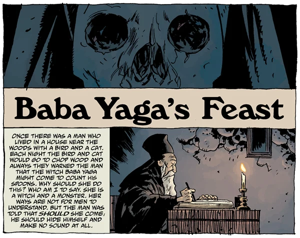

A short tale of [the Baba Yaga](/entry/Baba%20Yaga%20%28character%29).

## Publication History

*Baba Yaga's Feast* was published in March of 2009 as the backup story to *[The Wild Hunt](/entry/The%20Wild%20Hunt)* \#4. It was included in the *Hellboy: Weird Tales* hardcover collection in November 2014.

## Synopsis

An old monk sits at a desk recording a tale of [the Baba Yaga](/entry/Baba%20Yaga%20%28character%29). Once the Baba Yaga came to a man's house, but his cat and bird were able to scare her away. However, one time she found the man and took him away to her house. She told her daughter to cook the man for breakfast. The man tricked the daughter to climb into the pot, and quickly pushed her into the fire. When Baba Yaga returned she found food waiting for her and ate. Death came and told her that she had eaten her own child. The man fled and lived the rest of his life in a monastery.

## Connections to Other Stories

This tale is narrated by the same monk as *[How Koshchei Became Deathless](/entry/How%20Koshchei%20Became%20Deathless)*.

**Category:Story**