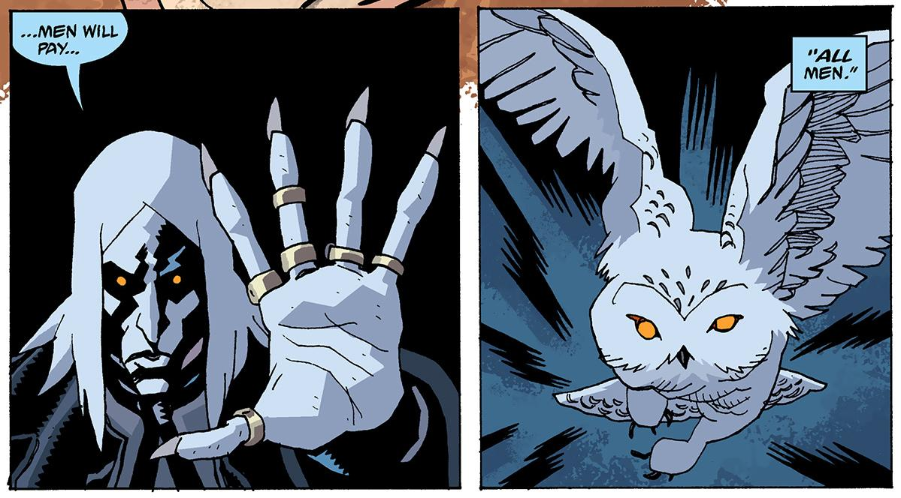

**Baron Konig** was a vampire that [Trevor Bruttenholm](/entry/Trevor%20Bruttenholm) encountered in 1946. Unlike other vampires, Konig transforms not into a bat, but into a white owl.

## History

While [Trevor Bruttenholm](/entry/Trevor%20Bruttenholm) and [Varvara](/entry/Varvara), head of the Soviet paranormal department, were investigating what is left of Project Vampir Sturm, Baron Konig appears before them and threatens Prof. Bruttenholm. Konig was furious about the abuse of [Vladimir Giurescu](/entry/Vladimir%20Giurescu) and his wives that were captured by the Nazis; for that, he swore that all men will pay for their abuse. Varvara then decided she has heard enough, and forces the vampire to flee.[1]

Later Konig flew into a Soviet holding facility for Nazis with knowledge of the Reich's paranormal activities. He killed the man responsible for overseeing Project Vampir Sturm and flies away.[2]

In 1947, Baron Konig kept his promise in which he slaughtered a train car full of S.S. officers, which proves to be one in a larger list of Nazi killings. In response Bruttenholm sent a team of four men to investigate a lead on Konig, which wold be a party he threw in the summer of 1771.[3]

Konig attended an annual gathering of vampires and witches to invoke the Goddess [Hecate](/entry/Hecate). A human in their company, B.P.R.D. agent [Simon Anders](/entry/Simon%20Anders), reveals to the attending audience about Konig's killings, and that because of this some people are becoming aware about vampires. The vampires had planned to stay in hiding until humanity had forgotten how to fight them; as a result, Konig's actions infuriate many of the vampires present. Although he argued that they are being shortsighted and attempted to rally them to his cause; however, they instead beat him up before finally killing him by slitting his throat which, in turn, caused Konig to crumble into dust.[4]

## Trivia

- Although not mentioned in the stories he appeared, Konig's first name is Ernst according to the sketchbook in [*B.P.R.D. vol. 9 1946*](/entry/TPB).

## Notes

<references/>

**Category:Characters** **Category:Vampires** **Category:Undead** **Category:Male Characters**

[1] *B.P.R.D.: [1946](/entry/1946)* \#3

[2] *B.P.R.D.: 1946* \#5

[3] *B.P.R.D.: [1947](/entry/1947)* \#1

[4] *B.P.R.D.: 1947* \#2