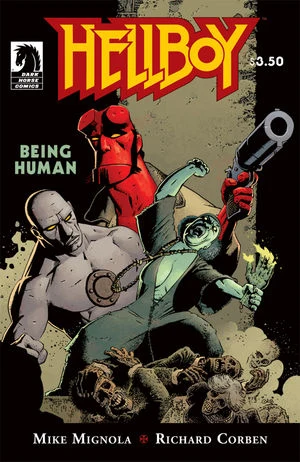

《**生而为人**》（Being Human）是一个以[地狱男爵](/entry/Hellboy_(character))与[罗杰](/entry/Roger)为主角的任务回忆故事。

## 出版历史

这一单行本期号于 2011 年 5 月出版。尽管原刊挂的是《地狱男爵》的名号，故事却于 2011 年 11 月收录进平装合订本《[B.P.R.D.：生而为人](/entry/Trade_Collections)》，此后又收入[《地狱男爵——第 2 卷：异乡奇所》全集版](/entry/Omnibus_Editions)。

## 剧情简介

一个邪恶女巫带着她的僵尸仆从，为一屋子尸体摆下一场晚宴；地狱男爵与罗杰现身，把它们统统轰回地狱——这是罗杰在 B.P.R.D. 早期岁月里的一篇搭档故事。

## 故事年表

确切时间不详。它必定发生在《[满盒邪祟](/entry/Box_Full_of_Evil)》之后、2000 年《[征服之虫](/entry/Conqueror_Worm_(story))》之前。

## 内容

### 角色

#### [B.P.R.D.](/entry/Bureau_for_Paranormal_Research_and_Defense)

- [罗杰](/entry/Roger)
- [托马斯·曼宁](/entry/Thomas_Manning)
- [地狱男爵](/entry/Hellboy_(character))
- 无名医生
- [莉兹·谢尔曼](/entry/Elizabeth_Sherman)（回忆）

#### 奎伦一家

- 维吉尼乌斯·奎伦（本姓特恩博）（仅被提及）
- 克莱顿·奎伦
- 比尤拉·奎伦
- 利瓦伊·奎伦
- 霍默·奎伦
- 克莱顿·奎伦的私生女

#### 其他

- 坦帕警察局（TPD）
  - 无名警官
  - 奥斯卡·休斯（仅被提及）
- 伏都僵尸

### 地点

- 美国
  - [B.P.R.D.](/entry/Bureau_for_Paranormal_Research_and_Defense)总部（康涅狄格州费尔菲尔德）
  - 奎伦宅邸（南卡罗来纳州河角镇）
- 罗马尼亚（回忆）
  - 切格城堡废墟（回忆）
    - [罗杰的](/entry/Roger)制造者工坊（回忆）
  - 瓦尔研究所（特尔戈维什泰）（回忆）
  - 马扎尔南多尔（Magyarnándor）（回忆）

### 重要器物

- 荣光之手（Hand of Glory）

**Category:Story** **Category:Hellboy story** **Category:B.P.R.D. story**
