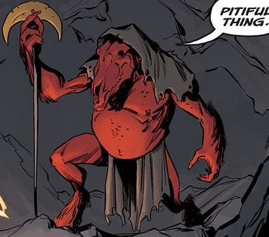

**Berith** was a demon that attempted to cross in the mortal world through a human host.

## History

After the death of [Satan](/entry/Satan) and the slave uprising in [Pandemonium](/entry/Pandemonium), several demons attempted to escape to the mortal world. Berith was one of such that seduced a mortal named Trent to become his vessel. [Ashley Strode](/entry/Ashley%20Strode) prevented him from fully crossing over and sent him back to Hell.

## Powers & Abilities

According to himself, he commanded legions, before Pandemonium's fall.

## Trivia

- In Christian demonology Berith is in the Chief Secretary of Hell, a demon who tempted man with blasphemy and murder.

**Category:Characters** **Category:Male Characters** **Category:Demons** **Category:Villains**