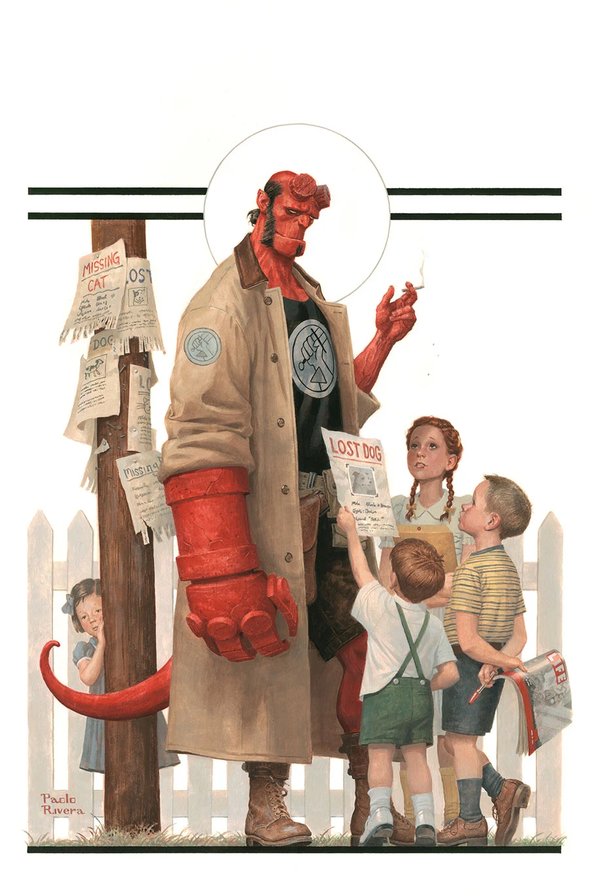
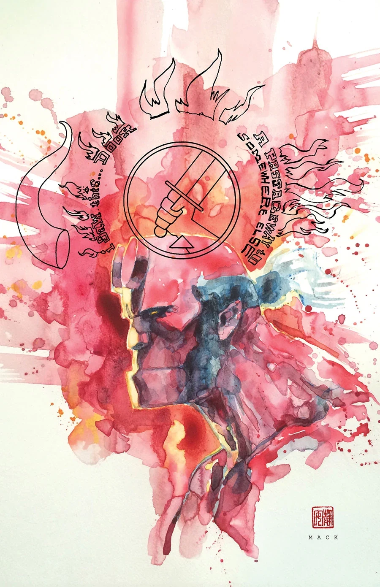
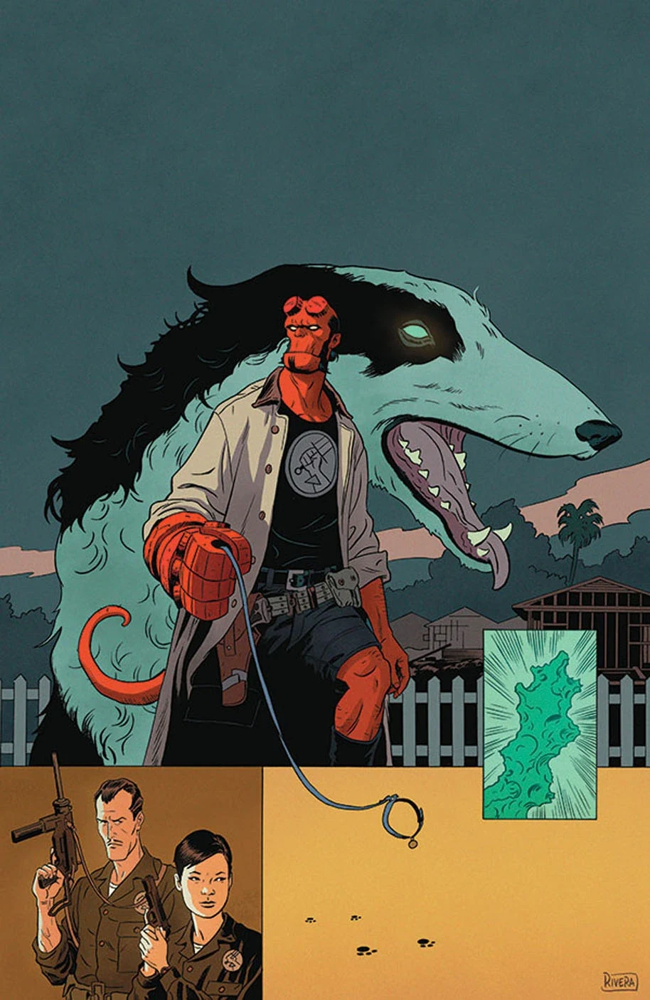
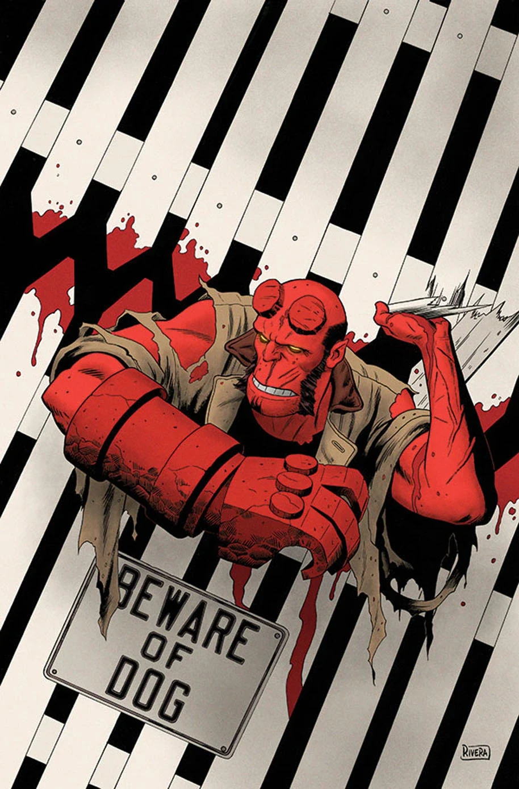

《**栅栏之外**》（Beyond the Fences）是一个三期故事，由迈克·米格诺拉（Mike Mignola）与克里斯·罗伯森（Chris Roberson）编剧，保罗·里维拉（Paolo Rivera）与乔·里维拉（Joe Rivera）作画。它是构成《[地狱男爵与 B.P.R.D.](/entry/Hellboy_and_the_B.P.R.D.)：1953》的数个故事之一。

## 剧情简介

### 第一部

一头神秘生物在一座田园诗般的郊区小镇猎食孩童。[B.P.R.D.](/entry/Bureau_for_Paranormal_Research_and_Defense) 介入调查，却发现事情远比预想的棘手——而且这案子透着一股诡异的熟悉感。

### 第二部

[地狱男爵](/entry/Hellboy_(character))与一头怪异生物正面交锋，宁静的郊区随之被撕得四分五裂；与此同时，B.P.R.D. 试图查明：究竟是谁造出了这样一头怪物，又为了什么。

### 第三部

在一次冷战时期的任务中，人类最好的朋友成了地狱男爵最可怕的噩梦。

## 画廊

除特别注明外，封面均由 [保罗·里维拉](/entry/Paolo_Rivera)（Paolo Rivera）绘制。

《1953》第 3 期

《1953》第 3 期变体封面，[大卫·麦克](/entry/David_Mack)（David Mack）绘

《1953》第 4 期

《1953》第 5 期

**Category:Story** **Category:B.P.R.D. story** **Category:Hellboy story** **Category:Hellboy and the B.P.R.D. story**
