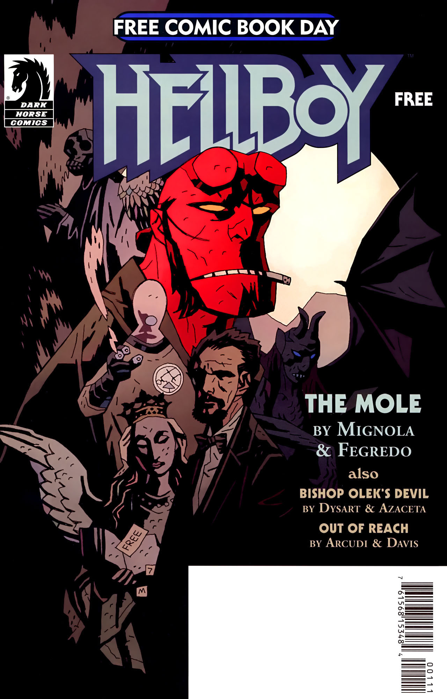

《**奥莱克主教的恶魔**》（Bishop Olek's Devil）是一部短篇故事，作为《[1946](/entry/1946)》迷你系列的前传，二者出自同一创作团队。它首次引入了霍华德·伊顿博士（Dr. Howard Eaton）这一角色——日后他与特雷弗·布鲁滕霍尔姆教授一同成为 [B.P.R.D.](/entry/Bureau_for_Paranormal_Research_and_Defense) 的创始成员。

## 出版历史

这篇八页短篇是 2008 年 5 月「免费漫画日」（Free Comic Book Day）推出的三篇漫画之一，后收录于平装合订本《[B.P.R.D.：1946](/entry/Trade_Collections)》中。

## 剧情简介

故事以霍华德·伊顿博士的第一人称视角叙述，追忆了他如何结识[特雷弗·布鲁滕霍尔姆教授](/entry/Trevor_Bruttenholm)，以及两人最早的一场冒险。

1939 年，伊顿在大英博物馆工作时被引荐给布鲁滕霍尔姆。两人一同被派往东加利西亚（Galacia），调查一位「马尔科·彼得罗夫领主」的说法：此人声称持有一部失散已久的魔法书《魔典对话录》（*Dialogus Goetia*）。相传这部书由一位乌克兰神职人员奥莱克桑德主教（Bishop Oleksander）写成——1592 年，他为换取秘术知识而把灵魂卖给了魔鬼。跋涉数月之后，伊顿与布鲁滕霍尔姆抵达了彼得罗夫的庄园。

入住第一夜，两人就被庄园仆从反锁在房间里，还听到一阵令人不安的啜泣声。第二天，他们见到了卧病在床的彼得罗夫领主。此人声称，两个多世纪前他曾打通一条通往异域空间密室的通道，那部《魔典对话录》就藏在其中，他也因此把书取到了手。他邀请布鲁滕霍尔姆拿走这本书，又试图以书中蕴藏的力量诱惑他。布鲁滕霍尔姆假意对书的真伪表示存疑，就此结束了这场会面。

入夜，布鲁滕霍尔姆与伊顿逃出房间，潜入彼得罗夫的卧室。在那里，他们撞见骇人的一幕：这位年迈的领主正被一只寄生恶魔慢慢吸干精血——那怪物外形酷似一只畸形的海星。逃跑时，伊顿伸手去抓那本书，以免它落入敌手。可就在他触碰书本的一瞬，彼得罗夫的身体化为石头、碎裂开来，怪物随即将注意力转向新的宿主——伊顿。布鲁滕霍尔姆急忙让伊顿把书扔给自己，好让自己成为怪物关注的焦点。在他试图脱身时，彼得罗夫幽魅的声音响起，劝诱布鲁滕霍尔姆：此书带来的回报，值得让那守护恶魔每夜造访。布鲁滕霍尔姆被引到奥莱克主教的秘密墓室，把书放回这位死去主教的手中，诅咒就此终结，那畸形守护者的直接威胁也随之解除。

伊顿回味着这段经历：布鲁滕霍尔姆如何激励他去追求一种充实而充满冒险的人生。

## 参考、风格与讨论

故事以配角伊顿的第一人称视角，来见证主角布鲁滕霍尔姆的行动，这种手法令人联想到华生医生转述[夏洛克·福尔摩斯](https://en.wikipedia.org/wiki/Sherlock_Holmes)冒险的叙事方式。在某些方面，它在风格上也接近早期的超自然侦探小说，例如威廉·霍普·霍奇森笔下「捉鬼人卡纳基」（Carnacki the Ghost-Finder）的系列冒险。

故事中的「守护者」在风格上近似蒙塔古·罗兹·詹姆斯经典鬼故事《托马斯修道院院长的宝藏》（*The Treasure of Abbot Thomas*）里的守护恶魔。佐证之一是墓室中出现的「*Depositum Custody*」字样——它化用了同一篇故事里的「*Depositum Custodi*」（意为「守护好托付于你的事物」）。詹姆斯也素来爱用被邪祟附身（有时与神秘学相关）的古董器物，正如此处的《魔典对话录》。

这部名为《魔典对话录》（*Dialogus Goetia*）的神秘学魔法书，其灵感可能源自围绕[《魔鬼圣经》（Codex Gigas）](https://en.wikipedia.org/wiki/Codex_Gigas)及现实世界其他一些历史魔法书的传说。

**Category:Story** **Category:B.P.R.D. story** **Category:B.P.R.D.: 1946–1948 story**
