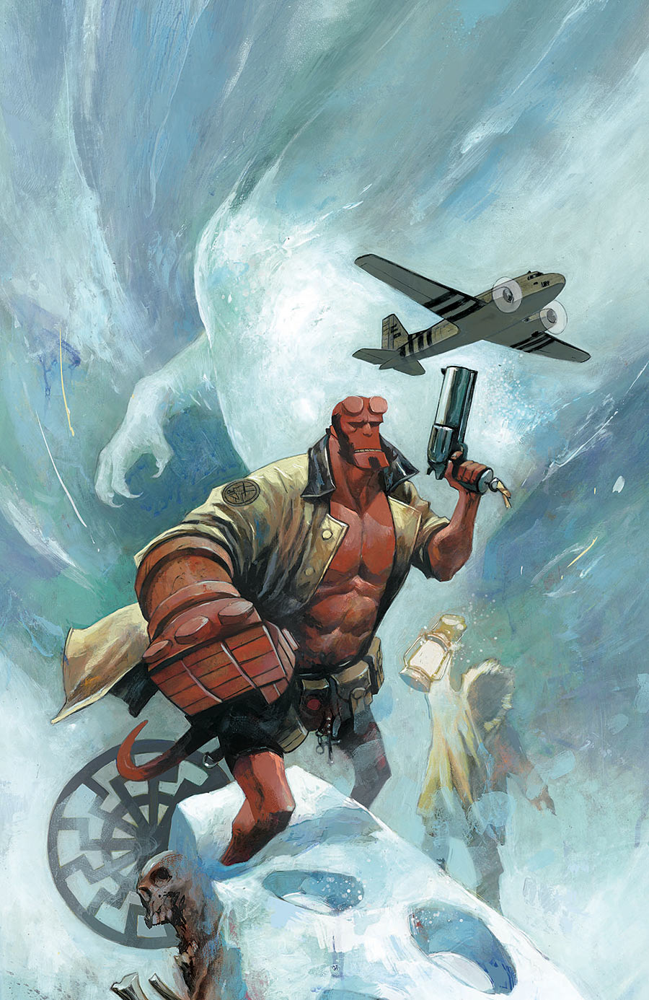

《**黑日**》（Black Sun）是《[地狱男爵与 B.P.R.D.](/entry/Hellboy_and_the_B.P.R.D.)：1954》的一个两期篇章，由迈克·米格诺拉（Mike Mignola）与克里斯·罗伯森（Chris Roberson）编剧，斯蒂芬·格林（Stephen Green）作画。

## 剧情简介

### 第一部

北极科考队在一次考察中遭到未知生物袭击，地狱男爵与 B.P.R.D. 奉命前往调查。早已不是菜鸟的地狱男爵以为自己能立刻解开谜团，可他们在冰雪中的发现却表明：这头巨兽背后，还藏着一个大得多的阴谋。

### 第二部

地狱男爵与 B.P.R.D. 大部队失散，却发现自己置身于一位老对手的身旁——对方手握一件新武器，还打算拿地狱男爵来试刀。

## 画廊

封面均由 [迈克·赫德尔斯顿](/entry/Mike_Huddleston)（Mike Huddleston）绘制。

《1954：黑日》第 1 期

**Category:Story** **Category:B.P.R.D. story** **Category:Hellboy story** **Category:Hellboy and the B.P.R.D. story**
