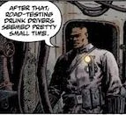

**Lieutenant Bradley** is a [B.P.R.D.](/entry/B.P.R.D.) agent who appeared in [*War on Frogs* \#2](/entry/War%20on%20Frogs).

## History

Lieutenant Bradley had been serving as a Michigan State trooper since prior to 1987. In that year, he assisted Hellboy in a hunt for a lake monster which later influenced him into joining the B.P.R.D.

In 2005, Bradley lead a ill-fated team of B.P.R.D. agents on a mission to investigate a possible frog monster nest in an abandoned battleship on the Californian coast. As his team were gradually picked apart, Bradley tried to lead the team out of the situation and hold them together psychologically. Unfortunately, Bradley became the frog monster's next victim. After being ambushed he is cut across the throat and dies instantly.

## Trivia

- Unlike many B.P.R.D. agents drafted from the military during the *War on Frogs*, Bradley has had prior experience with the B.P.R.D. in 1987.

**Category:Deceased Characters** **Category:Male Characters** **Category:Humans** **Category:B.P.R.D. agent** **Category:Americans**