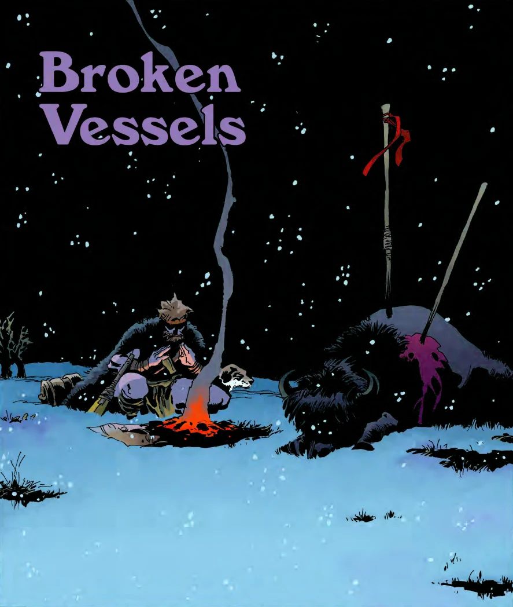

This short story originally appeared in the *[Hellboy Winter Special](/entry/Hellboy%20Winter%20Special)*. It is the Hellboy Universe debut of Tim Sale. The story focuses on [Gall Dennar](/entry/Gall%20Dennar) in prehistoric times. It is the only Hellboy universe story which does not fall under a specific title as it has not been collected or tied to any other stories.

## Synopsis

While camping on a snow-covered plain, Gall Dennar is approached by a man wearing a robe of skulls. The skulls belonged to shamans capable of harnessing the [Vril](/entry/Vril). The man had dug them up, hoping to learn its use. He claimed the skulls whispered to him how the Vril was used to make Hyperborea a paradise.

As the man speaks he is surrounded by faceless specters. Each grabs a skull which they place over their face. As the specters fly away, the man dies, declaring that it shows the Vril power remains, but that it wasn't meant for man.

**Category:Story**