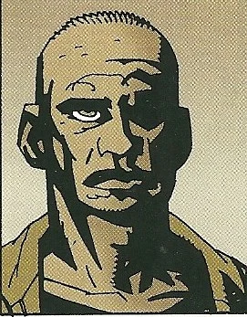

**Bud Waller** was a [B.P.R.D.](/entry/Bureau%20for%20Paranormal%20Research%20and%20Defense) Field Agent.

## History

On a mission to find the castle of [Vladimir Giurescu](/entry/Vladimir%20Giurescu), Bud Waller, along with [Liz Sherman](/entry/Liz%20Sherman) and new agent [Sidney Leach](/entry/Sidney%20Leach), were sent to the ruins of the Czege Castle in Romania. There the team found a large metal door Leach was able to discover with his ability to detect metal. The door led to a large alchemist's lab with a dead, abnormally large [homunculus](/entry/Roger) inside. Despite Waller's warnings, Liz transferred her pyrokinetic energy into it, unexpectedly bringing the creature to life. In a failed attempt to remove Liz from the monster, Leach's hands were badly burned. Waller was then forced to shoot Liz in the arm in order to cut off her flow of energy to the homunculus. The homunculus panicked, breaking Waller's neck and spine before escaping. The agent died instantly.

## Trivia

- An "Agent Waller" is mentioned by name in the [Hellboy Animated](/entry/Hellboy%20Animated) film *Blood and Iron.*

**Category:Characters** **Category:B.P.R.D. agent** **Category:Humans** **Category:Male Characters** **Category:Deceased Characters** **Category:Americans**