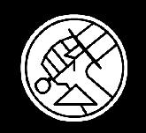
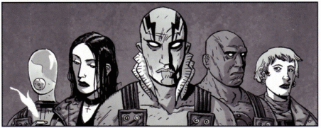

 The **Bureau for Paranormal Research and Defense** (the **B.P.R.D.** or **BPRD**) is an organization charged with protecting America and the world from the occult, paranormal and supernatural. It retains the services of several supernatural persons, including [Hellboy](/entry/Hellboy%20%28character%29). The BPRD originally appeared in the *Hellboy* comics but has also been featured in many stories under the *BPRD* title.

## History

The B.P.R.D. was founded in late 1944 by Professor [Trevor Bruttenholm](/entry/Trevor%20Bruttenholm) to combat various occult threats uncovered in operations against Nazi Germany. It initially had strong links to the United States Army Air Forces and was based at a military airbase in New Mexico.  By 1948, the Bureau relocated to a custom built facility in Fairfield, Connecticut. It maintains strong links to various branches of the United States Armed Forces to this day. It is a private organization that receives funding from several major governments (mostly the United States and United Kingdom, although other countries like Canada, Japan, France, and Italy have been mentioned). Professor Bruttenholm served as director until the late 1950's when he stepped down to return to field work. The current Director is Dr. Thomas Manning. Since the 1970's, additional paranormal agents have joined the ranks, such as [Liz Sherman](/entry/Liz%20Sherman), [Abraham Sapien](/entry/Abraham%20Sapien), [Johann Kraus](/entry/Johann%20Kraus), and [Ben Daimio](/entry/Ben%20Daimio). This has become necessary to maintain the high profile of the Bureau, especially in light of the departure of their flagship agent, [Hellboy](/entry/Hellboy), in 2001.

## [Plague of Frogs](/entry/Plague%20of%20Frogs%20%28story%20cycle%29)

The B.P.R.D. is a well known and respected organization that has excellent relations with most international governments and United States government agencies, with the exceptions of China and the CIA. The Bureau was initially the United States' only defense against an onslaught of frog creatures. Though the 'frogs' originally began operating on the East Coast, they spread west on both sides of the US-Canadian border. To cut costs, the Bureau moved from its long-time headquarters in Connecticut to an abandoned research facility in Colorado. This facility was last used to house Nazi scientists who defected to America after World War II. As such, the facility contains vast amounts of secret files that the B.P.R.D. has yet to explore.

The frog monster invasion reached its peak during the events of *[The Black Flame](/entry/The%20Black%20Flame%20%28story%29)*. A Nazi madman called the [Black Flame](/entry/Landis%20Pope) insinuated himself as the leader of the frogs, and together they raised [Katha-Hem](/entry/Katha-Hem) (one of the Ogdru Hem, the 369 spawn of the [Ogdru Jahad](/entry/Ogdru%20Jahad)) from the ground. The beast ran rampant across the American heartland until Liz Sherman used an [ancient artifact](/entry/Spiked%20Cylinder) to amplify her pyrokinetic powers a thousandfold. After she burned Katha-Hem alive, the frog monsters dragged the Black Flame into a vast pit and the invasion came to an end.

## [Hell on Earth](/entry/Hell_on_Earth_(story_cycle)))

The B.P.R.D. has recently become an international organization with support from the United Nations. This is due to the major Ogdru Hem activity occurring throughout the world. The Bureau has also been unable to rely on their enhanced talent agents as of late. Former Team Captain Ben Daimio fled the Bureau after causing the death of several agents. Agent Liz Sherman is currently missing following her destruction of the frog army and the Black Flame at Agartha. Agent Abe Sapien is currently on the run after awakening from a 4 month coma brought on by severe injuries. His time spent in a coma has left him transformed and his fellow agents even more suspicious of him and his role in the end of the world. Due to this lack of enhanced talent agents, the more traditional agents have had to step up as the world falls apart.

## Agents

Some notable BPRD agents. Left to right: <a href="Johann_Kraus" title="wikilink">Johann Kraus</a>, <a href="Liz_Sherman" title="wikilink">Liz Sherman</a>, <a href="Abe_Sapien" title="wikilink">Abe Sapien</a>, <a href="Roger" title="wikilink">Roger</a>, <a href="Kate_Corrigan" title="wikilink">Kate Corrigan</a>.

### Enhanced Talents Agents

- [Johann Kraus](/entry/Johann%20Kraus) - ectoplasmic physical medium
- [Liz Sherman](/entry/Liz%20Sherman) - [pyrokinetic](http:///index.php?title=Pyrokinesis&action=edit&redlink=1)
- [Fenix Espejo](/entry/Fenix%20Espejo) - psychic
- [Panya](/entry/Panya) - ageless mummy and psychic
- Dr. Izar Hoffman - psychic
- [Hellboy](/entry/Hellboy%20%28character%29) - World's Greatest Paranormal Detective, Beast of the Apocalypse
- [Abe Sapien](/entry/Abe%20Sapien) - icthyo-humanoid, formerly Langdon Caul (currently on the run)
- Captain [Ben Daimio](/entry/Ben%20Daimio) - team leader, [were-jaguar](http:///index.php?title=Olmec_were-jaguar&action=edit&redlink=1) (deceased)
- [Roger](/entry/Roger) - homunculus (deceased)
- [Sidney Leach](/entry/Sidney%20Leach) - psychically detects and manipulates metal (possibly retired)

### Human Agents - Present Day B.P.R.D.

- Dr. Tom Manning - director
- [Dr. Kate Corrigan](/entry/Kate%20Corrigan) - former liaison to enhanced talents agents, current field director
- [Professor James Henry O'Donnell](/entry/Professor%20James%20Henry%20O%27Donnell) - occult specialist
- [Pauline Raskin](/entry/Pauline%20Raskin) - former field agent, responsible for training new agents
- [Andrew Devon](/entry/Andrew%20Devon) - field agent
- [Carla Giarocco](/entry/Carla%20Giarocco) - field agent
- [Ashley Strode](/entry/Ashley%20Strode) - field agent
- Vaughn - field agent; currently traveling with the warlock [Gustav Strobl](/entry/Gustav%20Strobl) (deceased)
- [Nichols](/entry/Nichols) - field agent
- Rebecca Gervesh - field agent
- [Enos](/entry/Enos) - field agent (deceased)
- [Ted Howards](/entry/Ted%20Howards) - field agent
- Tian - field agent
- Salvatore Tasso - field agent (deceased)
- [Trevor Bruttenholm](/entry/Trevor%20Bruttenholm) - former director (deceased)

### Human Agents - 1940s B.P.R.D.

- Professor Trevor Bruttenholm, director 
- [Tim Clark](/entry/Tim%20Clark)
- [Jacob Stegner](/entry/Jacob%20Stegner), field agent (*[1947](/entry/1947)*, *[1948](/entry/1948)*)
- [Simon Anders](/entry/Simon%20Anders), field agent (*[1947](/entry/1947)*, *[1948](/entry/1948)*, *[Vampire](/entry/Vampire%20%28story%29)*)
- Margaret Laine, secretary
- General Norton Ricker, U.S. Military
- Mac, the dog
- Dr. Howard Eaton - (deceased) - (appears in [1946](/entry/1946), [Bishop Olek's Devil](/entry/Bishop%20Olek%27s%20Devil))
- [Frank Russell](/entry/Frank%20Russell), field agent (deceased) - (appears in [1947](/entry/1947))
- [Gabriel Ruiz](/entry/Gabriel%20Ruiz), field agent (deceased) - (appears in [1947](/entry/1947))

### Human Agents (Supporting, background, or deceased)

- Dr. Roddel, scientist
- Dr. Cobb, scientist
- Dr. Arnold Platt, scientist (deceased)
- Doris, medical doctor
- Peter, techie responsable for overseeing the Oannes' superhuman bodies
- Jim, techie
- Lloyd, mechanic - Wake the Devil
- Izzy Kemper, cult expert, linguist
- [Garrett Omatta](/entry/Garrett%20Omatta), psychic medium
- Josh Ecton, psychic
- Agent Lashley, field agent - The Black Flame
- Agent Navarro, field agent - The Black Flame
- Agent Catlett, field agent - War on Frogs
- Agent Swanson, field agent
- Agent Helton, field agent
- Agent Brandaux, field agent (deceased)- Wasteland
- Agent Kris Peters, field agent (deceased) - The Pickens County Horror
- Agent Lehane, field agent (deceased) - The Abyss of Time
- [Bud Waller](/entry/Bud%20Waller), field agent/mechanic (deceased) - Wake The Devil
- Clark, field agent (deceased) - Wake The Devil
- Lieutenant Bradley, field agent (deceased) - War on Frogs \#2
- Agent Demers, field agent (deceased) - War on Frogs \#2
- Agent Varadi, field agent (deceased) - War on Frogs \#2
- Agent Kohler, field agent (deceased) - War on Frogs \#2
- Agent Whitcomb, field agent (deceased) - War on Frogs \#2
- Agent Bernie D'Andrea, field agent (deceased) - War on Frogs \#2
- Agent Bama, field agent (deceased) - War on Frogs \#2
- Agent Ferguson, field agent (deceased)
- Agent Musgrove, field agent (deceased) - The Killing Ground
- Agent Holcombe, field agent (deceased) - The Killing Ground
- Agent Pratt, field agent (deceased) - The Drowning
- Agent Hampton, field agent (deceased) - The Drowning
- Agent Van Fleet, field agent (deceased) - The Drowning
- Wilson, pilot (turned into a [frogman](/entry/Ogdru%20Jahad), presumed deceased) - Plague of Frogs
- Possibly The Finn, a friend of Hellboy's
- Agent Hamilton, field agent (deceased) - Hellboy Animated
- FBI Special Agent [John Myers](/entry/John%20Myers), Hellboy liaison (1st movie only)
- Agent Clay, field agent (deceased) - Hellboy movie

sv:Byrån för Paranormal Forskning och Försvar de:Behörde zur Untersuchung und Abwehr paranormaler Erscheinungen

**Category:Organizations**