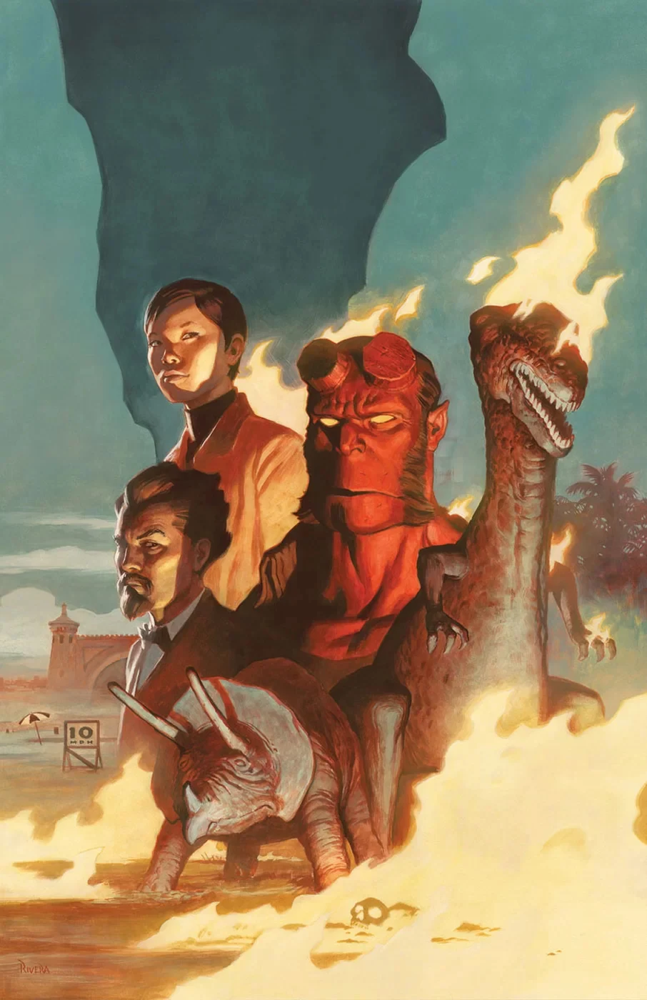

《**燃烧季节**》（Burning Season）是《[地狱男爵与 B.P.R.D.](/entry/Hellboy_and_the_B.P.R.D.)：1955》的一个单期完结篇章，由迈克·米格诺拉（Mike Mignola）与克里斯·罗伯森（Chris Roberson）编剧，保罗·里维拉（Paolo Rivera）与乔·里维拉（Joe Rivera）作画。

## 剧情简介

[地狱男爵](/entry/Hellboy_(character))与[苏珊](/entry/Susan_Xiang)、[布鲁姆教授](/entry/Trevor_Bruttenholm)一同调查佛罗里达一座小镇上接连发生的人体自燃事件——这种超自然现象他前所未见，而且那火焰似乎专爱拿[调查局](/entry/Bureau_for_Paranormal_Research_and_Defense)探员开刀。

- 保罗·里维拉回归执笔！

**Category:Story** **Category:Hellboy story** **Category:B.P.R.D. story** **Category:Hellboy and the B.P.R.D. story**
