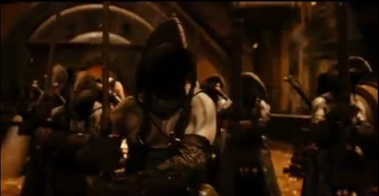

King Balor's Butcher Guards preparing to battle Prince Nuada

The **Butcher Guards** are the personal guards of King Balor and were dispatched in a matter of minutes by his son Prince [Nuada](/entry/Nuada). They are seen in the movie *Hellboy 2: The Golden Army* briefly in which Prince Nuada kills all of them with ease. They are lightly armored, however they carry formidable weapons, which includes a large butcher-knife looking sword (hence the name butcher guards) and carry a smaller sword on their backs. It is not clear if they were selected as guards by Balor or whether it was tradition to have Butcher Guards.

## Physical Appearance

The Butcher Guards all stand at the same height and are bronze skinned. It is unknown how their faces look because of the large beak shaped helmet they wear. They also have false hair extensions on the back of their helmets, which makes them look as if they all have long dark hair. It is also unknown what race they are but are presumably elves.

## Assassination of King Balor

When Nuada appeared to kill his father, the Butcher Guards were always too slow to stop him. When he is confronted at the entrance by an official, he nearly beheads him before any of the Butcher Guards can stop him, and is only stopped by his sister's arrival. During the actual battle, he dispatches the guards with ease, although it is unknown whether this is due to their poor fighting skills or Nuada's great skill in battles. It is presumed that they were killed easily because of Nuada's great skills or else they would not have been selected to guard the highest ranking official amongst the magic world. Despite being cut down easily, they remain loyal to King Balor and fight to the last man.

**Category:Monsters** **Category:Elves** **Category:Hellboy II: The Golden Army** **Category:Hellboy II: The Golden Army characters** **Category:Characters (2004–2008 film franchise)**