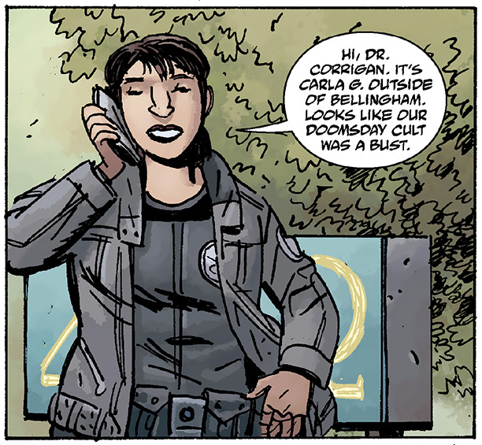
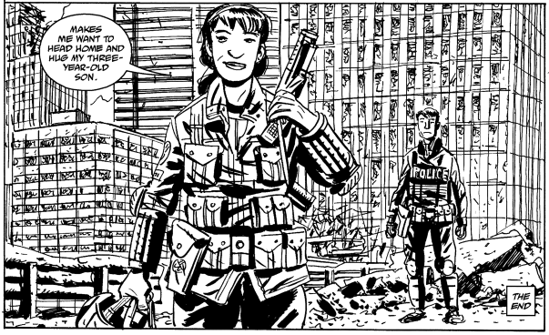
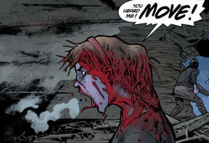
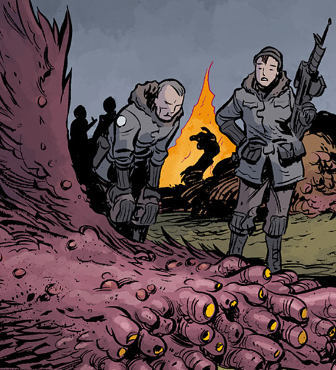

**Carla Giarocco** is a [B.P.R.D.](/entry/B.P.R.D.) field agent working under [Kate Corrigan](/entry/Kate%20Corrigan) along side the enhanced talents agents. A fairly recent addition to the B.P.R.D, she has quickly gained ground as a skilled asset and key foot soldier in humanity's battle against the Ogdru Jahad and their many servants.

## Character Biography

### *King of Fear*

In the course of [Elizabeth Sherman](/entry/Elizabeth%20Sherman)'s apocalyptic visions of the future and destruction of the B.P.R.D, Liz saw Carla's body among the ruins of the Bureau's armed forces - a potentially prophetic view of Carla's continuing contributions to the Bureau and, possibly, her doom.

### *New World*

** Carla first appearance was investigating reports of a doomsday cult in Bellingham along side [Abe Sapien](/entry/Abe%20Sapien), only to discover it was a hoax started by local college students. Upon arrival Abe had abandoned the other agents to follow his own leads involving the wendigo and [Ben Daimio](/entry/Ben%20Daimio) without informing anyone else.

### *Seattle*

 As events escalated in the wake of *[King of Fear](/entry/King%20of%20Fear%20%28story%29)*, Carla later represented the B.P.R.D when the city of Seattle was attacked by a giant monster, working alongside local authorities and the army to destroy the creature before it could level the entire city.

In the wake of their victory, a local police officer asks if she thinks humanity can win in their struggle. Giarocco responds that she does not know, but that her three year old son is one of the things that keeps her fighting.

### *The Long Death*

** Not long after Seattle, Carla was once again back in the field along side [Johann Kraus](/entry/Johann%20Kraus) and a dozen other agents to investigate a series of dissappearances in British Columbia; the same area where Abe had located and defeated an Ogrdu Hem earlier in the year. With Abe [wounded in action](/entry/The%20Devil%27s%20Engine), Johann elected to lead the operation. However, his true reasons were to enact revenge against the possesed Daimio who was hiding in the area and whom Abe had met in secret. Upon arrival, like Abe before, Johann abandoned the team to hunt on his own. That night Daimio, now under the control of the Jaguar demon, attacked and decimated the team. Carla was successful in driving the creature off with a grenade at point blank range but suffered serious injuries in the process.

### *The Return of the Master*

 As she recuperated she wrote a scathing report on Johann's actions - and after sufficiently recovering was rewarded for her brave actions by Kate Corrigan by being promoted to a field commander. In addition, she was recommended to [Iosif Nichayko](/entry/Iosif%20Nichayko) of the Russian S.S.S to assist in a particulary sensitive mission.

Sent to Scotland with a team she met with veteran B.P.R.D agent Sal Tasso and led a hunt across the Scottish highlands; their target was a Russian scientist name Lazar who had escaped [Iosif's wrath](/entry/Russia). Soon, events escalated out of control as Lazar revealed himself as a conduit for the rebirth of [a greater power](/entry/Rasputin) and unleashed a variety of supernatural forces upon Carla, Sal and her team in a desperate struggle.* *Carla and ten other agents managed to survive the battle with Lazar and were rescued from an emerging Ogdru Hem by the arrival of the Russian [Special Sciences Service](/entry/Special%20Sciences%20Service) thanks to the efforts of director [Iosif Nichayko](/entry/Iosif%20Nichayko).

### *A Cold Day in Hell*

Carla accompanies S.S.S. director Nichayko and his men on a mission to defend an isolated radio tower from an attack by demons.

### *Lake of Fire*

Carla reunites with her fellow agents after arriving back to the Colorado base following her stay in Russia.  Carla is present at a senior B.P.R.D. meeting and learns of the upcoming mission of going into New York City, which has been unreachable since the second wave of Ogdru Hem activity spawned by the [Black Flame](/entry/The%20Black%20Flame%20%28character%29).  She later learns about the prowess ofAgent Howards and requests him to accompany her squad alongside Agents Gervesh, Nichols, and Enos.  Carla and her team will be working alongside the S.S.S. under director Nichayko as they enter New York City through New Jersey. 

### *The Reign of the Black Flame*

## Abilities

Carla is a normal human agent with no supernatural abilities - however, she has shown herself to be resourceful and skilled in the heat of battle.

**Category:Female Characters** **Category:B.P.R.D. agent** **Category:Humans** **Category:Americans**