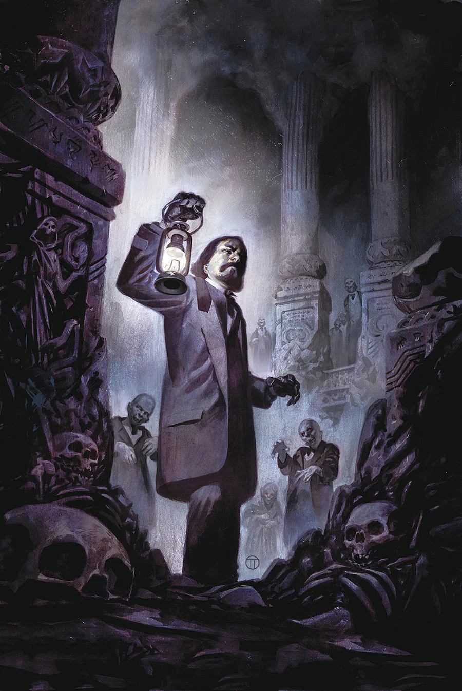

***City of the Dead*** is a five-issue miniseries written by [Mike Mignola](/entry/Mike%20Mignola) and [Chris Roberson](/entry/Chris%20Roberson) with [Ben Stenbeck](/entry/Ben%20Stenbeck) on art duties and [Julián Totino Tedesco](/entry/Juli%C3%A1n%20Totino%20Tedesco) on covers.

## Synopsis

### Part One

Sir Edward Grey, occult adviser to the queen, confronts flesh-eating corpses and discovers a temple beneath London. The mystery that compels him the most is what the sinister Heliopic Brotherhood of Ra wants with it—and from him.

### Part Two

After narrowly surviving an attack by risen corpses in a London cemetery, Sir Edward Grey follows his only lead to a dead end, but the Heliopic Brotherhood of Ra may be able to reveal what is behind the undead.

### Part Three

Sir Edward Grey travels beneath London to the lair of a longtime enemy who needs his help fighting an even greater threat.

### Part Four

When an old enemy emerges as the ringleader of the risen dead, Sir Edward Grey appeals to a higher power of his own to fight back.

### Part Five

The Witchfinder returns to the secret chambers of London’s underground…

## Gallery

文件:City of the Dead 1.jpg|Issue \#1 文件:City of the Dead 2.jpg|Issue \#2 文件:City of the Dead 3.jpg|Issue \#3 文件:City of the Dead 4.jpg|Issue \#4 文件:City of the Dead 5.jpg|Issue \#5

**Category:Story** **Category:Witchfinder story**