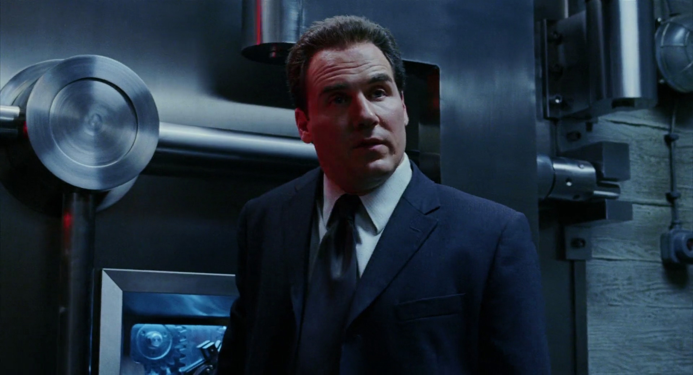

Agent Clay was a BPRD agent that debuted in the [first *Hellboy* film](/entry/Hellboy%20%28film%29), but has made no further appearances.

## Movie

Agent Clay was [Hellboy](/entry/Hellboy%20%28character%29)'s liaison for a number of years before the position was given to [Agent Myers](/entry/John%20Myers). He and Hellboy have a good rapport, to the point that Hellboy teases him about getting a hair transplant to hide that he's balding.

His role throughout the first movie is as a competent agent that is teamed with Hellboy and acts as backup to Hellboy while they discover [Sammael](/entry/Sammael) in the museum.

He is partnered with Hellboy when they descend into the NY subway system to locate the resurrected Sammael's eggs. While in the subway, assassin [Karl Ruprecht Kroenen](/entry/Karl%20Ruprecht%20Kroenen) appears and splits Hellboy from the rest of the group with Agent Clay following as backup. While in pursuit, Agent Clay and Hellboy become separated and Karl Kroenen attacks Agent Clay, stabbing him multiple times before laying Agent Clay down and entering a state of suspended animation himself.

When Hellboy finds the two of them, he calls for medical intervention.

The last we hear of Agent Clay, acting director of BPRD operations Tom Manning castigates Hellboy for being reckless and losing Quarry and Moss while that Agent Clay would not likely live through the night.

de:Clay

**Category:B.P.R.D. agent** **Category:Characters (2004–2008 film franchise)** **Category:Hellboy (2004 film) characters**