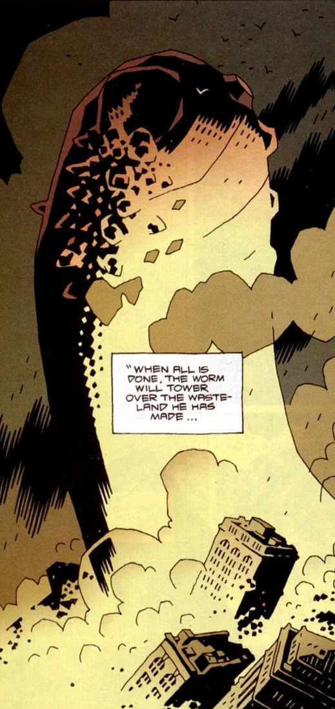

*This article is about the Ogdru Hem. For the comic miniseries see*[Conqueror Worm (story)](/entry/Conqueror%20Worm%20%28story%29)*.*

The **Conqueror Worm** was one of the 369 Ogdru Hem, the children of the [Ogdru Jahad](/entry/Ogdru%20Jahad).

## History

In 1939, the Nazis, eager to establish a decisive advantage against the Allies in World War II (the same eagerness that led to their funding of [Project Ragna Rok](/entry/Project%20Ragna%20Rok)), somehow made contact with malevolent entities in space (what [Hellboy](/entry/Hellboy%20%28character%29) half-facetiously called "space ghosts"), who promised that, if a dead body was sent into space for one of them to inhabit, it would return to Earth with the power to crush their enemies.

The Nazis sealed the corpse of the recently-assassinated Dr. [Ernst Oeming](/entry/Ernst%20Oeming) into a space suit and launched it aboard a space capsule from Hunte Castle in Austria, but the project was halted by [Lobster Johnson](/entry/Lobster%20Johnson).

Sixty-one years later, [Herman von Klempt](/entry/Herman%20von%20Klempt) entered Hunte Castle and reactivated the old equipment, sending the recall signal to bring Dr. Oeming's capsule back to Earth. When it landed, the Conqueror Worm emerged. The Worm emitted a gas that could instantly transform people into frog monsters, which it then devoured to grow in size and strength.

A representative of the alien race that monitored the [Ogdru Jahad](/entry/Ogdru%20Jahad)'s prison warned Hellboy and [Roger](/entry/Roger) that, if it was not stopped, it would become powerful enough to destroy all life on Earth, and then summon the Ogdru Jahad from their prison.

The Worm was defeated by Hellboy, Roger, and the ghost of the Lobster, using a power cell given to Hellboy by the alien.

[Grigori Rasputin](/entry/Grigori%20Rasputin), who had led von Klempt to Hunte Castle in the hopes of awakening the Ogdru Jahad, was vexed by the Worm's defeat, and [Hecate](/entry/Hecate), inhabiting the iron maiden that had killed [Ilsa Haupstein](/entry/Ilsa%20Haupstein), mocked that no matter what Rasputin tried, the only force that could release the Ogdru Jahad was the [Right Hand of Doom](/entry/Right%20Hand%20of%20Doom), which remained in Hellboy's possession, and Hellboy remained outside of Rasputin's control. Rasputin flew into such a rage that he exploded into bone fragments.

The Conqueror Worm had similar abilities to [Sadu-Hem](/entry/Sadu-Hem), which had appeared at Cavendish Hall and reappeared during the [Plague of Frogs](/entry/Plague%20of%20Frogs).

## Background Information

The Conqueror Worm takes its name from the poem of the same name by Edgar Allan Poe. It was also used as the American title of the British horror film *Witchfinder General*, starring Vincent Price.

**Category:Ogdru Hem** **Category:The Ogdru Jahad and their Agents**