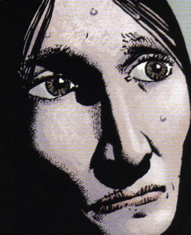

 **Cora Fisher** was an inhabitant of the area near The Hurricane in the Appalachian mountains who had grown up with [Tom Ferrell](/entry/Tom%20Ferrell) and had married her childhood sweetheart.

Sadly enough, after losing both her husband and children she was tempted into becoming a witch (presumably by [Effie Kolb](/entry/Effie%20Kolb)) in service to [The Crooked Man](/entry/Jeremiah%20Witkins).

When Tom and [Hellboy](/entry/Hellboy%20%28character%29) confronted her with it she sought to repent her misdeeds, but when they passed over the coal mines haunted by Melungion witches they caused her to explode in a swarm of luminescent demonic critters.

This wasn't the end of her though as her spirit went ahead to [Reverend Watts](/entry/Reverend%20Watts)' church and notified him of the impending arrival of Tom and Hellboy. She then stood by them when the Crooked man and his minions laid siege to the church. Her spirit was last seen standing next to the reverend, with Tom having made plans for a marker for her it can be assumed she was able to rest in peace.

**Category:Witches** **Category:Minor Character** **Category:Characters** **Category:Deceased Characters** **Category:Spirits** **Category:Female Characters** **Category:Humans** **Category:Americans**