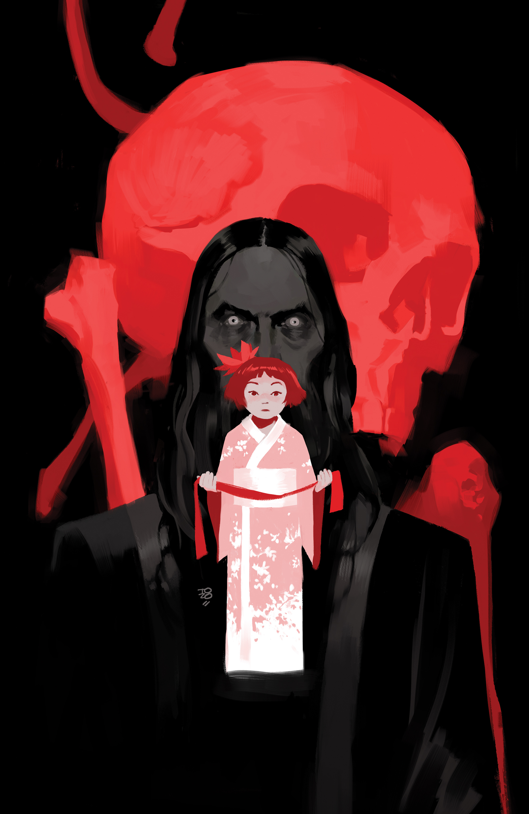

***Crimson Lotus*** is a five-issue miniseries about [Yumiko Daimio](/entry/Yumiko%20Daimio). It is [Mindy Lee](/entry/Mindy%20Lee)'s Hellboy Universe debut.

## Publication History

The *Crimson Lotus* miniseries was revealed for San Diego Comic-Con 2018 as a part of the 25th Anniversary of Hellboy announcements.

## Synopsis

### Part One

Before she became Lobster Johnson’s biggest foe, the Crimson Lotus was a young girl whose family was caught up in the Russo-Japanese war. Thirty years later, the Lotus exacts her revenge with terrifying international ramifications, and two spies must try to chase her through China before they become flies in her web.

## Gallery

Covers by [Tonci Zonjic](/entry/Tonci%20Zonjic).

<File:Crimson> Lotus 1.jpg|Issue \#1

**Category:Story** **Category:Comics**