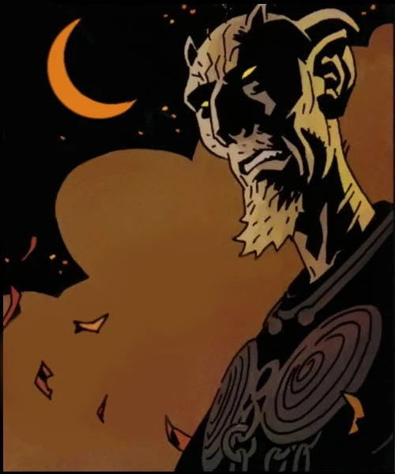

**Dagda** was the most prominent fairy king of the Daoine Sidhe, and the last High King of the Tuatha De Danann, the old gods of Ireland.

## History

His encounters with [Hellboy](/entry/Hellboy%20%28character%29) were few and far between, but he was often seen to be observing from afar the one he called 'the Beast'. Dagda was likely to have been one of the oldest and most influential beings in the Hellboy universe, but he would nevertheless meet an untimely end when he was betrayed by one of his own, stabbed in the back by a frenzied crony of the renegade fairy [Gruagach](/entry/Gruagach). His death would have lasting ramifications, as along with the murdered fairy queen Mab, Dagda was the last pureblooded inheritor of the Tuatha De Danann. The spilling of his golden blood presages the inevitable end of the fairy folk. The fairy race is now probably doomed to extinction.

**Category:Characters** **Category:Male Characters** **Category:Deceased Characters** **Category:Deities** **Category:Daoine Sidhe** **Category:Hellboy characters**