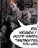

Agent **Demers** is a [B.P.R.D.](/entry/B.P.R.D.) operative and minor character appearing in [*B.P.R.D.: War on Frogs* \#2](/entry/War%20on%20Frogs).

## History

In 2005, Demers was part of the B.P.R.D. team, led by Lieutenant Bradley, sent to investigate a possible frog monster nest on an abandoned battleship on the Californian coast. As the team are gradually picked off one by one Demers is the last survivor. Eventually escaping onto the deck of the ship Demers confronts the frog monster that has been killing his squadmates armed only with a broken pipe. It is later revealed that Demers died killing the frog monster in the process.

**Category:Male Characters** **Category:Deceased Characters** **Category:B.P.R.D. agent** **Category:Humans** **Category:Americans**