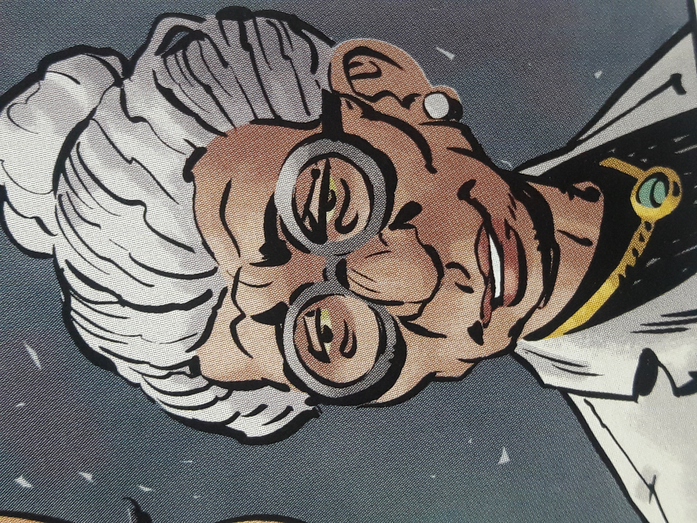

**Dr. N.K. Sandhu**was an British Indian that acted as a scientific advisor for the [B.P.R.D.](/entry/Bureau%20for%20Paranormal%20Research%20and%20Defense)

## History

During the early 1950s, Sandhu had been established at the Institute of Psychiatry in London. There she acted as an educator to the B.P.R.D.'s wards with psychic or supernatural abilities, such as [Susan Xiang](/entry/Susan%20Xiang).

**Category:B.P.R.D. agent** **Category:Female Characters** **Category:Humans**