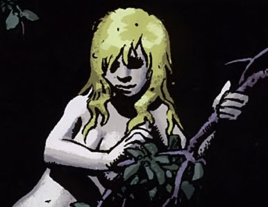
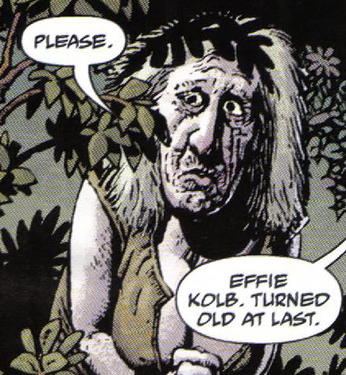

Ugly as sin doesn't always apply it seems

Effie Kolb was the right-hand woman, chief supporter and main witch of [Miser Witkins](/entry/Jeremiah%20Witkins).

## Story

Effie is the first witch [Tom Ferrell](/entry/Tom%20Ferrell) ever met, having taught Tom about the pleasures of female companionship along with tricking him into forming a pact with her master Witkins who maintains her youthful appearance. With Tim returns to Virginia, Effie plays with his head while revealing she turned his father into a horse that she ran ragged until he eventually died. Eventually reduced to an old woman after Witkins is finally destroyed, Effie receives little mercy from Tom as he collars her with the bridle she placed on his father so she would spend the rest of her known life as a nag. To add insult to injury, [Hellboy](/entry/Hellboy%20%28character%29) paints a warning on Effie's body to warn people to stay away from her.

## Powers and abilities

Effie Kolb worked as a recruiter for the Crooked Man over the years, bringing many women to witchcraft and their souls to her master. Aside from having vast knowledge of witchcraft she exhibited the ability to ride a horse (actually Tom's transformed father) against his will, leap from his back to a great height and evade Hellboy's gunfire.

Her most prominent power is her retained youthfulness, she looks to be in her teens, but is at the end revealed to be much, much older. It is possible she crafted the [Magic horse's bit](/entry/Magic%20horse%27s%20bit), with or without the aid of the Crooked Man.

The ugly truth.

### Personality

Effie looks like a hillbilly belle, but has a pretty nasty personality. She thought it fun to ride Tom's father to his death, make light of Tom's plight and of others' misfortune. Without her youth or powers she is not very courageous though, trying to throw herself on the tender mercies of her foes.

### Trivia

- [Reverend Watts](/entry/Reverend%20Watts) knew her when she was actually young, she was no good then either.
- Some ghost and witch stories feature a farmer Kolb. Go figure.
- She does very little magic that the reader sees, but is given a lot of respect by other witches.

**Category:Villains** **Category:Characters** **Category:Witches** **Category:Female Characters** **Category:Humans** **Category:Americans**