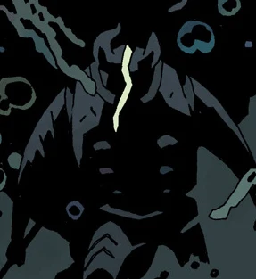

**Eligos** was a demon, a duke, and a knight of the Order of the Fly. He used to command sixty of Hell's legions, but after his defeat at [Hellboy's](/entry/Hellboy%20%28character%29) hands on the bridge of [Morgan Le Fey](/entry/Morgan%20Le%20Fey)'s castle during the events of *[The Wild Hunt](/entry/The%20Wild%20Hunt)*, he was stripped of his rank and power, and cast down into the pit.

When Hellboy arrives in The Abyss, on the outer edges of Hell, Eligos attacks him again, this time out for revenge. Eligos lays a beating on Hellboy before he is rescued by [Edward Grey](/entry/Edward%20Grey).

Eligos pursued the two to Grey's haven in Lethe. Edward Grey gets Hellboy clear and later tells Hellboy that he trapped Eligos there; hopefully forever.

**Category:Demons** **Category:Characters** **Category:Male Characters** **Category:Hellboy characters**