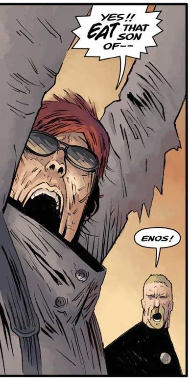

**Enos** is a recurring [B.P.R.D.](/entry/B.P.R.D.) field agent in the [Hell on Earth](/entry/Hell_on_Earth_(story_cycle))) story arc, first appearing in the story Wasteland as part of the team that recovered Agent Howards.

## History

Throughout the Hell on Earth arc Enos was frequently seen accompanying agents [Johann Kraus](/entry/Johann%20Kraus) and [Nichols](/entry/Nichols) until his eventual death in [Nowhere, Nothing, Never](/entry/Nowhere%2C%20Nothing%2C%20Never) fighting armed civilians protecting monsters. After his death agent Kraus possessed his corpse in order to use his weapon, defeating the armed locals. However Kraus' actions discomforted his fellow agents who from then on distanced themselves from him.

## Personality

Enos seems to have a somewhat unprofessional attitude to his job, often joking about the impending doom he often find him self in and once even cheering on an inter dimensional monster as it battled an Ogdru Hem. Enos is usually seen armed with heavy weaponry such as grenade launchers.

**Category:B.P.R.D. agent** **Category:Deceased Characters** **Category:Male Characters** **Category:Americans**