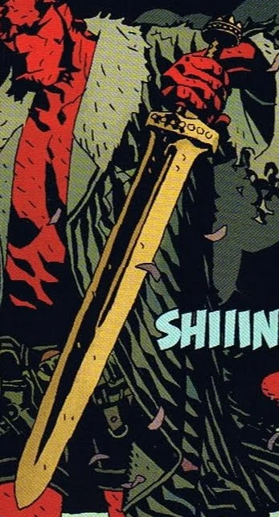

Excalibur2.jpg

**Excalibur** was the legendary sword wielded by King Arthur. After the death of Arthur the sword returns hundreds of years later. It is drawn from stone by Arthur's descendant, and the rightful king of Britain, [Hellboy](/entry/Hellboy%20%28character%29).

Hellboy wielded Excalibur for a brief amount of time, notably using the sword to slay [Nimue](/entry/Nimue)'s champion. However, once Hellboy made the decision to face Nimue on his own, he gave the sword to [Alice Monaghan](/entry/Alice%20Monaghan) to watch over. She later presented the sword to George Washbrook, who used Excalibur to lead the noble dead of Britain into battle against Nimue's army. After the battle was over Excalibur was said to have returned to the realm of legend.

**Category:Items**