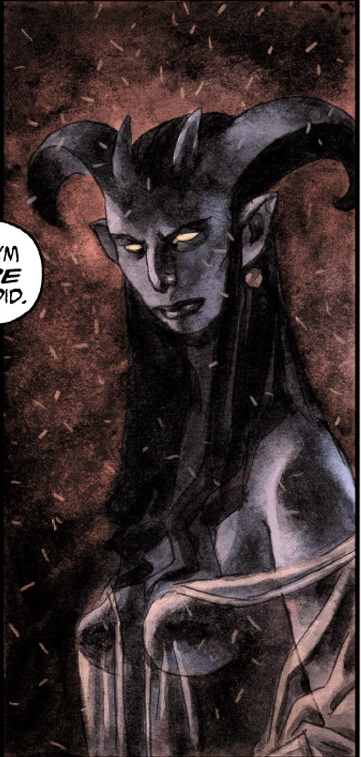

**Gamori** is the provocative sister of [Hellboy](/entry/Hellboy). She plotted to murder her younger brother in 1948, claiming he would eventually be the ruin of both herself and her uncle, [Astaroth](/entry/Astaroth). However, after a thwarted attempt at young Hellboy's life, Astaroth forbade Gamori from ever touching or plotting against Hellboy, so long as Astaroth still lived.

When Hellboy finally died and was sent to Hell, events led to the deaths of Astaroth and Gamori's brothers [Lusk](/entry/Lusk) and [Gamon](/entry/Gamon). Gamori blamed Hellboy for her relatives' deaths and sent the [Erinyes](/entry/Erinyes) to punish him. However, the Erinyes judged Hellboy to be innocent and they tried Gamori for lying to them. After Gamori was taken away, the Erinyes revealed to Hellboy that once Gamori was finally released from her judgement, she would be sent to follow a river of blood to [Pandemonium](/entry/Pandemonium). There, she would discover the source of the blood river to be from the cut throat of [Satan](/entry/Satan). Upon seeing the lord of Hell dead, Gamori went mad to the point that her screaming caused Pandemonium to crumble into ruins, thus forever destroying the heart of Hell.[1]

## Gallery

Hellboy Gamori clip.png|Gamori caught in the act of trying to kill Hellboy by Astaroth

## Sources

<references />

**Category:Characters** **Category:Female Characters** **Category:Demons** **Category:Hellboy characters**

[1] *[Hellboy in Hell: The Hounds of Pluto](/entry/The%20Hounds%20of%20Pluto)*