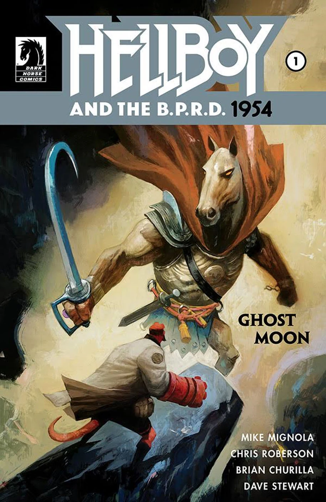
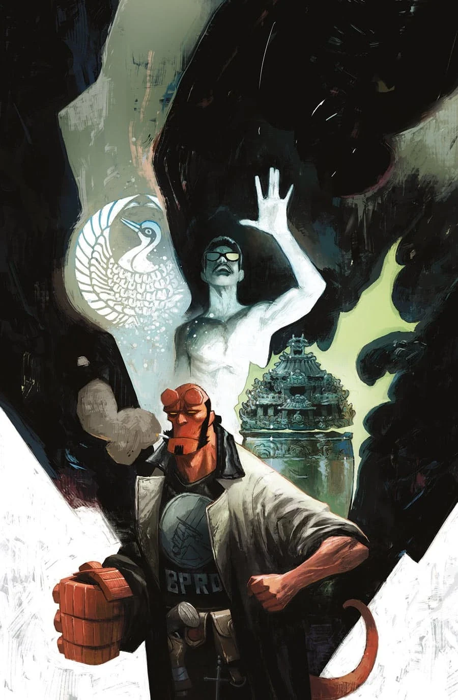

《**鬼月**》（Ghost Moon）是《[地狱男爵与 B.P.R.D.](/entry/Hellboy_and_the_B.P.R.D.)：1954》的一个篇章，由迈克·米格诺拉（Mike Mignola）与克里斯·罗伯森（Chris Roberson）编剧，布莱恩·楚里拉（Brian Churilla）作画。

## 剧情简介

### 第一部

布鲁滕霍尔姆的一位老友请托帮忙，地狱男爵于是前往香港的九龙城寨，追猎古老的中国妖魔。

### 第二部

地狱男爵与一对中国妖魔正面交锋；与此同时，苏珊则凭通灵能力追查这场香港超自然骚乱的源头。

## 《辛西娅女士究竟是谁？》

这篇两页后备短篇由马特·斯特拉克本（Matt Strackbein）自编自画，刊载于《地狱男爵与 B.P.R.D.：1954——鬼月》第 2 期，回顾了辛西娅·伊登-琼斯女士（Lady Cynthia Eden-Jones）的来历，未收录于任何合订本。

## 画廊

封面均由 [迈克·赫德尔斯顿](/entry/Mike_Huddleston)（Mike Huddleston）绘制。

《1954：鬼月》第 1 期

《1954：鬼月》第 2 期

**Category:Story** **Category:Hellboy story** **Category:Hellboy and the B.P.R.D. story** **Category:B.P.R.D. story**
