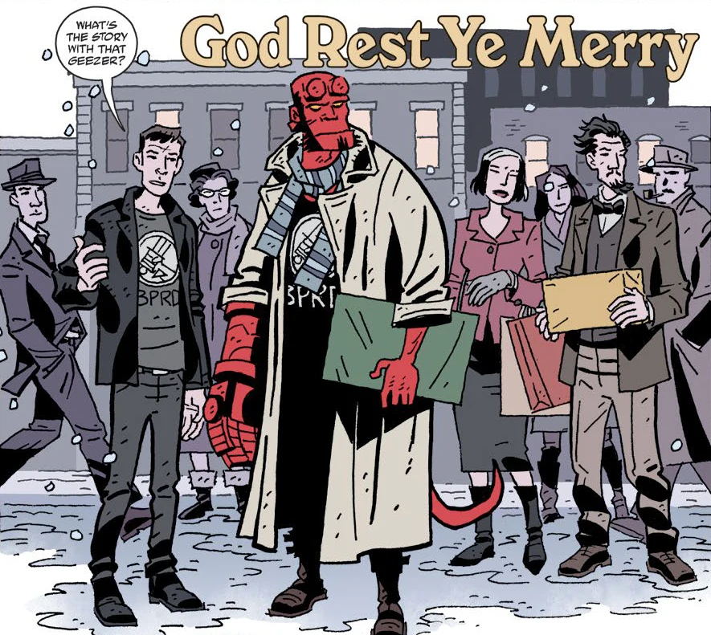

This short story originally appeared in the *[Hellboy Winter Special (2017)](/entry/Hellboy%20Winter%20Special%20%282017%29)*. It focuses on [Hellboy](/entry/Hellboy%20%28character%29), [Professor Bruttenholm](/entry/Trevor%20Bruttenholm), and "the Visitor" (see *[The Visitor: How & Why He Stayed](/entry/The_Visitor__How_%26_Why_He_Stayed)*). This story is the debut of artist [Paul Grist](/entry/Paul%20Grist) and colorist [Bill Crabtree](/entry/Bill%20Crabtree) on a Hellboy Universe title.

**Category:Story**