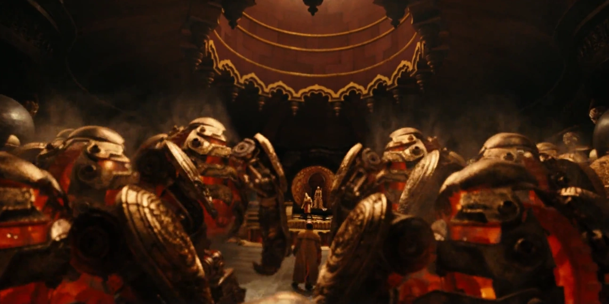
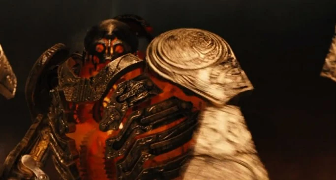

*关于 2008 年电影、其原声专辑与宣传漫画，见[《地狱男爵2：黄金军团》](/entry/Hellboy_II__The_Golden_Army)、[《地狱男爵2：黄金军团》（原声）](/entry/Hellboy_II__The_Golden_Army_%28soundtrack%29)与[《黄金军团》（宣传漫画）](/entry/The_Golden_Army_(promo))。*

**黄金军团**（Golden Army）是一支由"七十个七十"——即 4,900 个——机器人般的机械战士组成的军队，由[哥布林](/entry/Goblin)、[巨魔](/entry/Troll)与[精灵](/entry/Elf)在对抗[人类](/entry/Human)的[战争](/entry/War)中打造。

## 概述

三个种族在人类手下节节败退、苦不堪言，但凭借黄金军团，他们迅速扭转战局，击败了入侵的人类军队。然而，当初下令打造军团的精灵国王憎恶它们在战场上那种无情、如机器一般的做派，决定与人类议和，并将整支军团封存于北爱尔兰的巨人堤道（Giant's Causeway），令其陷入沉睡。许多个时代之后，权欲熏心的精灵王子[努阿达](/entry/Nuada)再度唤醒军团，向人类复仇。

## 历史

军团最初由一名哥布林铁匠提议打造，他渴望博得[巴洛王](/entry/Balor)的尊重；当巴洛王在人类的猛攻面前陷入绝望时，便同意让这名铁匠为他建造一支庞大的军团。

当人类再度进军时，大地震颤，逼近的黄金军团令天空都黯淡下来。这场攻势势不可挡，嗜虐的黄金军团连伤兵也一并屠戮，无人生还。或许有人会说，人类挑起战争是罪有应得，但暴力真的能解决暴力吗？

在军团野蛮屠杀无辜的人类之后，巴洛王痛恨军团所造下的恶，下令将其停用。哥布林铁匠表示同意，并坦言有时他真希望自己从未造出这支军团。

当哥布林把地狱男爵带到王子面前时，亚伯拉罕·塞皮恩将能够控制军团的贝斯莫拉王冠（Crown of Bethmora）的第三块碎片交给了努阿达——只要戴上这顶王冠，便是军团合法的领袖与君王。拥有王族血统者只需戴上王冠，宣布"我是国王（在此报上姓名），黄金军团的统治者。有谁质疑我的权利吗？"若黄金军团承认其王族血统，便会向这位统治者敬礼；若统治者受到另一个存在的挑战，则必须接受挑战。多年之后，当努阿达王子戴上王冠、自立为王时，这支不可阻挡的军团苏醒了。地狱男爵试图独自迎战黄金军团。最终，幽灵特工约翰·克劳斯附身于其中一个黄金军团战士，加入战斗。二人尚能与敌军周旋，但其中一个战士刺伤了克劳斯，迫使他回到自己原本的躯体。

黄金军团最终自我修复，将地狱男爵、丽兹、亚伯和约翰团团围住。无计可施之际，地狱男爵想起布鲁姆教授讲过的故事，向努阿达王子挑战，争夺指挥黄金军团的权利。努阿达王子声称地狱男爵并非王族，无权为军团的指挥权发起挑战。但娜拉公主告诉兄长，地狱男爵拥有王族血统——她称他为"[坠落者](/entry/Azzael)之子"。得知此事后，努阿达王子接受了挑战，二人交战，地狱男爵胜出。然而，努阿达不愿让任何其他人得到黄金军团的力量，企图杀死地狱男爵。幸而娜拉以自尽救了地狱男爵——因为一旦她受伤，她的兄长也会承受同样的伤。努阿达王子死后，地狱男爵一度受到诱惑、想要攫取黄金军团的力量，但丽兹·舍曼上前一步，用她的控火之力熔化了王冠，黄金军团就此永久停摆。
