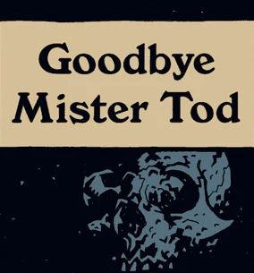

## Publication History

*Goodbye Mister Tod* was first published as a backup story in *Gary Gianni's MonsterMen* in August 1999. The story was later reprinted in [*Hellboy – Volume 4: The Right Hand of Doom*](/entry/TPB) in April 2000.

## Synopsis

In 1979, [Hellboy](/entry/Hellboy) travels to Portland, Oregon. Mary Ann Glozek, assistant to Mr. Tod, called the [B.P.R.D.](/entry/B.P.R.D.) for help. A few years before Hellboy had seen Mr. Tod, a physical medium, perform. However, Mr. Tod had fallen on hard times, and had started using drugs to help him get into trances. This time he contacted not the regular spirit world, but something else entirely in the form of a tentacled being that partial manifests from Mr. Tod's ectoplasm. Hellboy burns Arbutus, a herb used to chase away evil, but not before the creature grabs Hellboy. The Creature and Hellboy are sucked back into the body of Mr. Tod. Mr. Tod's body swells up and shatters, leaving Hellboy standing.

## Connections to Other Stories

In *[Conqueror Worm](/entry/Conqueror%20Worm%20%28story%29)* \#2, we learn that the creature in this story is of the same species as the [Conqueror Worm](/entry/Conqueror%20Worm). This would make the creature one of the Ogdru Hem.

When Hellboy mentions that he had seen Mr. Tod's act, we see the ectoplasmic form of a woman with her hair covered. An identical figure appears in *Sir Edward Grey, Witchfinder: [In the Service of Angels](/entry/In%20the%20Service%20of%20Angels)* \#2. While it is not known whether this is in fact the same spirit, it is the same type of seance, utilizing a spirit guide. This is a different method than say [Johann Kraus](/entry/Johann%20Kraus) who would project himself into the spirit world.

! colspan = 3 | [Vol. 4 The Right Hand of Doom](/entry/TPB)

sv:Adjö, Herr Tod

**Category:Story** **Category:Hellboy story**