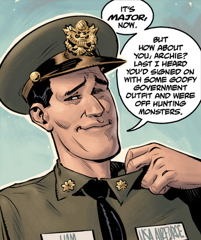

Major **​Hampton Taylor** ​was a major in the US Air Force.

## ​History

Hampton was a B-24 pilot in the Eighth Air Force during World War II, flying with his co-pilot, [Archie Muraro](/entry/Archibald%20Muraro). During a [BPRD](/entry/Bureau%20for%20Paranormal%20Research%20and%20Defense) investigation at Reynolds Air Force Base in the Marshall Islands during 1955, Hampton mentions to [Hellboy](/entry/Hellboy%20%28character%29), [Woodrow Farrier](/entry/Woodrow%20Farrier), [Jacob Stegner](/entry/Jacob%20Stegner), and Archie of the strange occurrences that happened over the week and of the E-Bomb. 

**Category:Humans** **Category:Male Characters** **Category:Americans**