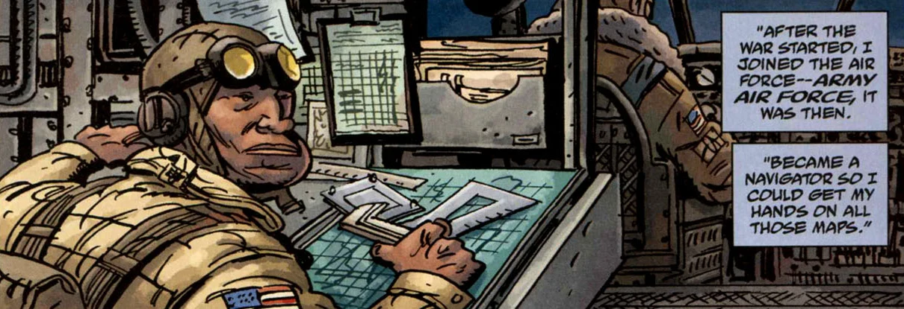
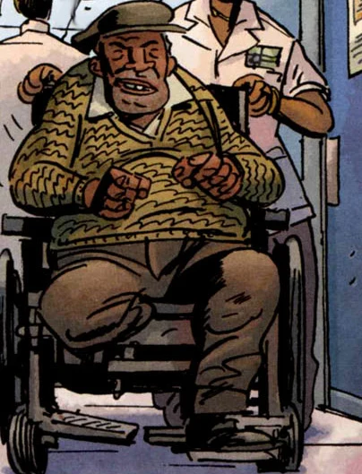

**Harold "Harry" McTell** was a member of [Lobster Johnson](/entry/Lobster%20Johnson)'s crew and served as a mechanic and gifted cartographer.

## History

### Early years

Though the exact circumstances of how he got involved with the Lobster are yet to be revealed, Harry McTell was recruited to the Lobster's crew of vigilante crimefighters in the early 1930's. He has at least some previous experience with the paranormal in which his grandfather was a houngan (a voodoo priest), who taught him about voodooism.

Chronologically, he dispenses well-intentioned advice to Cindy Tynan when she's been unsuccesful at gaining infomation from the locals about the Lobster and soon after revealed to be part of the Lobster's crew, putting his great muscle and superb mechanical skills to great effect. He's most likely constructed the vehicles seen in the Lobster's hideout and on more than one occasion has saved his boss's life by beating down a foe.

This did him only a little bit better than his friends when Lobster Johnson tried to solve the mystery of [Memnan Saa](/entry/Memnan%20Saa). Saa kept ahead of the crew whilst most of them mysteriously died. The Lobster abandoned the search when only he and Harry where left and they went their separate ways.

### Career in the military

 Harry McTell soon joined the Republic of China Air Force to help them fight the Japanese. After the end of the Second World War, McTell wound up in the United States Air Force, where he became a navigator doing scouting missions and later some covert ops in China during the Korean War. Though this was his main activity during these years he had not given up on finding Memnan Saa or hearing from the Lobster again after the Hunte Castle affair, which he accepted the fact that the man he had known is dead in spite of witnessing everything that the Lobster had overcome. This persistence cost him his right leg from the knee down, but as was revealed later his efforts would pay off.

### Old age

 Coming to age, Harry lives in a nursing home where a skeptical nurse is treated (and not for the first time by her expression) to a retelling of one of his old adventures with Lobster Johnson. [B.P.R.D.](/entry/B.P.R.D.) agent [Kate Corrigan](/entry/Kate%20Corrigan), however has business with him concerning the Lobster and Memnan Saa so her organization adjourn to his apartment. Filling in some of the blanks in the B.P.R.D.'s knowledge seems to give him the chance to finally address a willing audience that doesn't dismiss his ramblings. As a thank-you he gives Kate a map with an approximation of Memnan Saa's hidden base.

## Powers and abilities

Harry McTell was a very strong man in his prime, he had quite good people skills and a small penchant for subterfuge that got him quite a lot of info. He also functioned as chief-mechanic to the Lobster's crew and amassed quite a lot of knowledge on the supernatural during this time. He also was a secondary driver to the crew. his weapons of choice where his fists, close at hand as it where, though he also could fire arms.

### Vehicles

Harry McTell has driven, built, repaired and owned a wide variety of vehicles:

- A Tow-truck
- The Lobster's biplane
- [Massimo](/entry/Massimo)'s taxi
- A gangster-era car
- Boats docked at the seaport access in the Lobster's lair
- His wheelchair
- Several U.S. aircraft

## Trivia

- Harry never saw or heard from the Lobster again after they parted ways, even though he's led an active afterlife.
- Harry refers to the Lobster as "The Boss", respectfully.
- Harry was friends with [Massimo](/entry/Massimo) and took it rather badly when [the Black Flame](/entry/The%20Black%20Flame%20%28character%29) killed him and teleported themselves away.
- Apparantly Harry was also partly responsible for refurbishing an old cannon his crew used against the Black Flame.

## Appearances

- *[The Iron Prometheus](/entry/The%20Iron%20Prometheus)*
- *[The Black Goddess](/entry/The%20Black%20Goddess)*
- *[The Burning Hand](/entry/The%20Burning%20Hand)*
- *[A Scent of Lotus](/entry/A%20Scent%20of%20Lotus)*
- *[Get the Lobster!](/entry/Get_the_Lobster!))*
- *[The Forgotten Man](/entry/The%20Forgotten%20Man)*
- *[Metal Monsters of Midtown](/entry/Metal%20Monsters%20of%20Midtown)*
- *[Garden of Bones](/entry/Garden%20of%20Bones)*
- *[The Pirate's Ghost](/entry/The%20Pirate%27s%20Ghost)*

**Category:Characters** **Category:Lobster Johnson Characters** **Category:Lobster's crew** **Category:Male Characters** **Category:Americans**